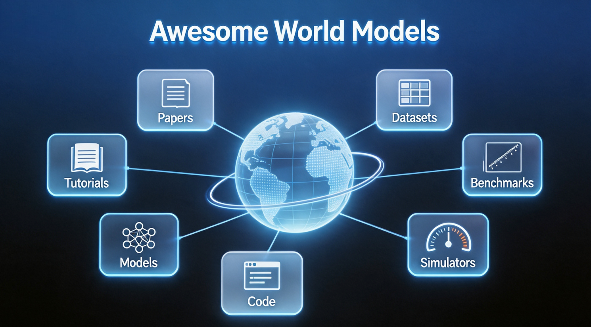

# 🎥 Awesome World Models

  

  

> 一份精心策划、面向学习者的世界模型研究资源清单：涵盖论文、数据集、基准测试、仿真平台、代码、模型和教程，既包括经典奠基性工作，也涵盖前沿进展，兼顾研究入门与工业部署。

✅ **收录标准**
- 优先选自 CVPR / ICCV / ECCV / NeurIPS / ICLR / ICML / RSS / AAAI / TPAMI 等顶级会议和期刊的高质量工作
- 覆盖核心前沿方向：基于语言的世界模型、视觉/视频世界模型、3D/4D 世界建模、潜在空间世界模型、以对象为中心的世界模型、符号与神经符号世界模型、交互式世界模型、世界行动模型（WAM）、视觉-语言-行动（VLA）、基于模型的强化学习、机器人与具身AI、自动驾驶、GUI/计算机使用智能体、科学模拟

---

## 目录
1. [综述与概述](#-综述与概述)
2. [教程与入门资源](#-教程与入门资源)
3. [奠基性论文与技术报告](#-奠基性论文与技术报告)
4. [核心世界模型范式](#-核心世界模型范式)
   - 4.1 [基于语言的世界模型](#41-基于语言的世界模型)
   - 4.2 [视觉/视频世界模型](#42-视觉视频世界模型)
   - 4.3 [3D 与 4D 世界模型（通用）](#43-3d-与-4d-世界模型通用)
   - 4.4 [潜在空间世界模型](#44-潜在空间世界模型)
   - 4.5 [以对象为中心的世界模型](#45-以对象为中心的世界模型)
   - 4.6 [符号与神经符号世界模型](#46-符号与神经符号世界模型)
   - 4.7 [通用基础世界模型](#47-通用基础世界模型)
5. [交互式世界模型](#-交互式世界模型)
   - 5.1 [通用交互框架](#51-通用交互框架)
   - 5.2 [游戏与开放世界探索（应用）](#52-游戏与开放世界探索应用)
6. [世界行动模型（WAM）与 VLA 集成](#-世界行动模型wam-与-vla-集成)
   - 6.1 [级联式 WAM](#61-级联式-wam)
   - 6.2 [联合式 WAM 与统一 VLA-世界模型](#62-联合式-wam-与统一-vla-世界模型)
   - 6.3 [用于 VLA 训练与评估的世界模型（组合范式）](#63-用于-vla-训练与评估的世界模型组合范式)
7. [基于模型的强化学习世界模型](#-基于模型的强化学习世界模型)
   - 7.1 [经典系列](#71-经典系列)
   - 7.2 [连续控制](#72-连续控制)
   - 7.3 [离线与泛化](#73-离线与泛化)
8. [应用领域](#-应用领域)
   - 8.1 [机器人与具身AI](#81-机器人与具身ai)
     - 8.1.1 [基础具身世界模型](#811-基础具身世界模型)
     - 8.1.2 [操作](#812-操作)
     - 8.1.3 [导航](#813-导航)
     - 8.1.4 [运动与运动-操作](#814-运动与运动-操作)
     - 8.1.5 [世界模型 × 策略学习](#815-世界模型--策略学习)
     - 8.1.6 [基于世界模型的策略评估](#816-基于世界模型的策略评估)
   - 8.2 [自动驾驶](#82-自动驾驶)
   - 8.3 [GUI / 计算机使用智能体](#83-gui--计算机使用智能体)
   - 8.4 [科学发现](#84-科学发现)
   - 8.5 [社会与经济模拟](#85-社会与经济模拟)
9. [数据集与基准测试](#-数据集与基准测试)
   - 9.1 [通用世界建模](#91-通用世界建模)
   - 9.2 [物理与因果](#92-物理与因果)
   - 9.3 [领域特定基准](#93-领域特定基准)
10. [训练与推理技术](#-训练与推理技术)
    - 10.1 [记忆机制](#101-记忆机制)
    - 10.2 [后训练与测试时扩展](#102-后训练与测试时扩展)
    - 10.3 [高效与实时推理](#103-高效与实时推理)
11. [仿真平台与物理引擎](#-仿真平台与物理引擎)
    - 11.1 [通用仿真平台](#111-通用仿真平台)
    - 11.2 [可微分物理引擎与神经模拟器](#112-可微分物理引擎与神经模拟器)
    - 11.3 [交互式世界模型与游戏引擎](#113-交互式世界模型与游戏引擎)
    - 11.4 [物理仿真与引擎集成](#114-物理仿真与引擎集成)
    - 11.5 [世界模型仿真基准](#115-世界模型仿真基准)
    - 11.6 [代码智能体与仿真构建](#116-代码智能体与仿真构建)
    - 11.7 [综述与观点](#117-综述与观点)
12. [理论、可解释性与立场](#-理论可解释性与立场)
    - 12.1 [理论与可解释性](#121-理论与可解释性)
    - 12.2 [立场与观点论文](#122-立场与观点论文)
13. [相关精选列表](#-相关精选列表)
14. [关键研究挑战](#-关键研究挑战)
15. [联系方式](#-联系方式)
16. [许可证](#-许可证)

---

## 📚 综述与概述

- **A Definition and Roadmap for World Models**
  - 发表：arXiv 2026
  - 亮点：为世界模型提供了科学定义，讨论了其关键技术方面，并提出了开发有效世界模型的分阶段路线图。
  - 论文链接：[arXiv](https://arxiv.org/abs/2607.06401)

- **World Models: A Comprehensive Survey of Architectures, Methodologies, Reasoning Paradigms, and Applications**
  - 发表：arXiv 2026
  - 亮点：全面综述了世界模型的架构、方法论、推理范式和应用；提出了一个按四个维度组织的多轴分类法。
  - 论文链接：[arXiv](https://arxiv.org/abs/2606.00133)

- **A Comprehensive Survey on World Models for Embodied AI**
  - 发表：arXiv 2026
  - 亮点：为具身AI中的世界模型提出了一个统一框架，采用三轴分类法，涵盖功能性、决策耦合与通用目的、以及时间建模。
  - 论文链接：[arXiv](https://arxiv.org/abs/2510.16732)

- **Towards Interactive Video World Modeling: Frontiers, Challenges, Benchmarks, and Future Trends**
  - 发表：arXiv 2026
  - 亮点：系统回顾了交互式世界建模的最新研究趋势、技术发展、评估基准和未来方向。
  - 论文链接：[arXiv](https://arxiv.org/abs/2606.01164)

- **World Action Models: A Survey**
  - 发表：arXiv 2026
  - 亮点：首次系统综述世界行动模型（WAM），厘清了世界模型、视频生成模型、动作驱动的视频世界模型、VLA策略和WAM之间的边界。
  - 论文链接：[arXiv](https://arxiv.org/abs/2606.20781)

- **From World Models to World Action Models: A Concise Tutorial for Robotics**
  - 发表：arXiv 2026
  - 亮点：将世界模型定义为动作条件预测模型，总结了四种代表性范式：先想象后执行、基于视频特征的动作预测、联合视频-动作建模、以及辅助视频预测。
  - 论文链接：[arXiv](https://arxiv.org/abs/2607.00836)

- **World Models for Robotic Manipulation: A Survey**
  - 发表：arXiv 2026
  - 亮点：通过三个问题调查了用于机器人操作的世界模型：预测何种未来表征、预测如何与动作连接、以及在机器人学习流程中何时使用。
  - 论文链接：[arXiv](https://export.arxiv.org/abs/2606.00113)

- **A Tutorial on World Models and Physical AI**
  - 发表：arXiv 2026
  - 亮点：通过共享的预测结构，为多样化的世界建模方法提供了一个统一的框架；将世界建模技术与物理AI应用（如机器人和自动驾驶）联系起来。
  - 论文链接：[arXiv](https://arxiv.org/abs/2606.12783)

- **Safety, Security, and Cognitive Risks in World Models**
  - 发表：arXiv 2026
  - 亮点：调查了世界模型的架构及其在安全关键领域的部署背景，刻画了世界模型资产库存和威胁面。
  - 论文链接：[arXiv](https://arxiv.org/abs/2604.01346)

- **How Should World Models Be Evaluated for Embodied Decision-Making? A Decision-Making-Centric Position**
  - 发表：arXiv 2026
  - 亮点：提出了一个从视觉合理性到策略优化效用的L0-L7评估阶梯，强调干预动作保真度和闭环展开有效性。
  - 论文链接：[arXiv](https://arxiv.org/abs/2606.15032)

- **3D and 4D World Modeling: A Survey**
  - 发表：arXiv 2025（v4 2026）
  - 亮点：首篇专注于3D和4D世界建模与生成的综述；建立了精确定义和结构化分类法，覆盖VideoGen、OccGen和LiDARGen；系统总结了领域特定数据集和评估指标。
  - 论文链接：[arXiv](https://arxiv.org/abs/2509.07996)

- **A Survey of World Models for Autonomous Driving**
  - 发表：arXiv 2025
  - 亮点：全面综述了用于自动驾驶的世界模型，涵盖从视频生成到4D占据预测的方法。
  - 论文链接：[arXiv](https://arxiv.org/abs/2501.11260)

- **World Model for Robot Learning: A Comprehensive Survey**
  - 发表：arXiv 2025
  - 亮点：全面综述了用于机器人学习的世界模型，重点关注策略学习。
  - 论文链接：[arXiv](https://arxiv.org/abs/2605.00080)

- **From Masks to Worlds: A Hitchhiker's Guide to World Models**
  - 发表：arXiv 2025
  - 亮点：一份关于世界模型的教程式指南。
  - 论文链接：[arXiv](https://arxiv.org/abs/2510.20668)

- **World Models in Artificial Intelligence: Sensing, Learning, and Reasoning Like a Child**
  - 发表：arXiv 2025
  - 亮点：从认知角度讨论世界模型。
  - 论文链接：[arXiv](https://arxiv.org/abs/2503.15168)

- **Is Sora a World Simulator? A Comprehensive Survey on General World Models and Beyond**
  - 发表：arXiv 2024
  - 亮点：全面综述了通用世界模型及其与视频生成的关系。
  - 论文链接：[arXiv](https://arxiv.org/abs/2405.03520)

- **Understanding World or Predicting Future? A Comprehensive Survey of World Models**
  - 发表：arXiv 2024
  - 亮点：广泛综述了世界模型，侧重于预测与理解。
  - 论文链接：[arXiv](https://arxiv.org/abs/2411.14499)

- **World Models: The Safety Perspective**
  - 发表：arXiv 2024
  - 亮点：关于世界模型安全挑战和风险的综述。
  - 论文链接：[arXiv](https://arxiv.org/abs/2411.07690)

---

## 🧪 教程与入门资源

- **Nano World Models: A Minimalist Implementation of Future Video Prediction**
  - 发表：arXiv 2026
  - 亮点：具有统一接口的未来视频预测的最小化实现。
  - 论文链接：[arXiv](https://arxiv.org/abs/2605.23993) | [网站](https://simchowitzlabpublic.github.io/nano-world-model/) | [代码](https://github.com/simchowitzlabpublic/nano-world-model)

- **minWM: A Full-Stack Open-Source Framework for Real-Time Interactive Video World Models**
  - 发表：arXiv 2026
  - 亮点：用于实时交互式视频世界模型的全栈开源框架。
  - 论文链接：[arXiv](https://arxiv.org/abs/2605.30263) | [代码](https://github.com/shengshu-ai/minWM)

- **StableWM: A Platform for Reproducible World Modeling Research and Evaluation**
  - 发表：arXiv 2026
  - 亮点：用于可复现世界模型研究与评估的平台。
  - 论文链接：[arXiv](https://arxiv.org/abs/2605.21800) | [网站](https://galilai-group.github.io/stable-worldmodel/) | [代码](https://github.com/galilai-group/stable-worldmodel)

---

## 📄 奠基性论文与技术报告

- **Video generation models as world simulators**（OpenAI Sora, 2024）
  - [技术报告](https://openai.com/research/video-generation-models-as-world-simulators)
  - 亮点：证明大规模视频生成可以作为世界模拟器。

- **A Path Towards Autonomous Machine Intelligence**（Yann LeCun, 2022）
  - 论文：[OpenReview](https://openreview.net/pdf?id=BZ5a1r-kVsf)
  - 亮点：LeCun 关于世界模型作为自主智能核心组件的愿景。

- **World Models**（Ha & Schmidhuber, 2018）
  - 论文：[arXiv](https://arxiv.org/abs/1803.10122) | [网站](https://worldmodels.github.io/)
  - 亮点：在深度学习中引入世界模型概念的开创性工作。

---

## 🧠 核心世界模型范式

### 4.1 基于语言的世界模型

- **Qwen-AgentWorld: Language World Models for General Agents**
  - 发表：arXiv 2026
  - 亮点：首个原生语言世界模型（35B-A3B 和 397B-A17B），通过长链式思维推理模拟7个领域的智能体环境，基于超过1000万条交互轨迹训练。
  - 论文链接：[arXiv](https://arxiv.org/abs/2606.24597)

- **WorldLLM: Improving LLMs' world modeling using curiosity-driven theory-making**
  - 发表：arXiv 2025
  - 亮点：利用好奇心驱动的理论构建来提升LLM的世界建模能力。
  - 论文链接：[arXiv](https://arxiv.org/abs/2506.06725)

- **Text2World: Benchmarking Large Language Models for Symbolic World Model Generation**
  - 发表：arXiv 2025
  - 亮点：首个评估LLM生成符号世界模型能力的基准。
  - 论文链接：[arXiv](https://arxiv.org/abs/2502.13092) | [网站](https://text-to-world.github.io/)

- **RAP: Reasoning with language model is planning with world model**
  - 发表：arXiv 2023
  - 亮点：将LLM推理形式化为使用世界模型进行规划。
  - 论文链接：[arXiv](https://arxiv.org/abs/2305.14992)

- **LWM: World Model on Million-Length Video And Language With RingAttention**
  - 发表：arXiv 2024
  - 亮点：基于RingAttention的百万长度视频和语言世界模型。
  - 论文链接：[arXiv](https://arxiv.org/abs/2402.08268) | [代码](https://github.com/LargeWorldModel/LWM)

- **Evaluating World Models with LLM for Decision Making**
  - 发表：arXiv 2024
  - 亮点：使用LLM评估世界模型在决策任务中的表现。
  - 论文链接：[arXiv](https://arxiv.org/abs/2411.08794)

- **LLMPhy: Complex Physical Reasoning Using Large Language Models and World Models**
  - 发表：arXiv 2024
  - 亮点：结合LLM和世界模型进行复杂物理推理。
  - 论文链接：[arXiv](https://arxiv.org/abs/2411.08027)

- **LLMCWM: Language Agents Meet Causality – Bridging LLMs and Causal World Models**
  - 发表：arXiv 2024
  - 亮点：通过因果推理桥接LLM和因果世界模型，用于语言智能体。
  - 论文链接：[arXiv](https://arxiv.org/abs/2410.19923) | [代码](https://github.com/j0hngou/LLMCWM/)

- **Making Large Language Models into World Models with Precondition and Effect Knowledge**
  - 发表：arXiv 2024
  - 亮点：利用前提和效果知识将LLM转化为世界模型。
  - 论文链接：[arXiv](https://arxiv.org/abs/2409.12278)

- **CityBench: Evaluating the Capabilities of Large Language Model as World Model**
  - 发表：arXiv 2024
  - 亮点：评估LLM作为城市级世界模型的能力。
  - 论文链接：[arXiv](https://arxiv.org/abs/2406.13945) | [代码](https://github.com/tsinghua-fib-lab/CityBench)

### 4.2 视觉/视频世界模型

- **Advancing Open-source World Models (LingBot-World)**
  - 发表：arXiv 2026
  - 亮点：源自视频生成的开源世界模拟器，具有高保真度和稳健动力学。
  - 论文链接：[arXiv](https://arxiv.org/abs/2601.20540)

- **Infinite Worlds with Versatile Interactions (LingBot-World 2.0 / LingBot-World-Infinity)**
  - 发表：arXiv 2026
  - 亮点：高级迭代版本，具备无界交互视界、60 fps 720p实时渲染、多样交互元素和智能体套件。
  - 论文链接：[arXiv](https://arxiv.org/abs/2607.07534) | 微信：[链接](https://mp.weixin.qq.com/s/c85iqjY_8EZQHPFdLaRIbw)

- **Next Forcing: Causal World Modeling with Multi-Chunk Prediction**
  - 发表：arXiv 2026
  - 亮点：多块预测框架，实现更快训练、更高精度和加速推理。
  - 论文链接：[arXiv](https://arxiv.org/abs/2606.11187)

- **Orca: The World is in Your Mind**
  - 发表：arXiv 2026
  - 亮点：BAAI的通用世界基础模型，从多模态信号中学习统一潜在空间；预训练于12.5万小时视频和1.6亿事件标注。
  - 论文链接：[arXiv](https://arxiv.org/abs/2606.30534) | 微信：[链接](https://mp.weixin.qq.com/s/5G3Rc5o9yEThojhhECq2Lw)

- **Qwen-RobotWorld: Unifying Embodied World Modeling through Language-Conditioned Video Generation**
  - 发表：arXiv 2026
  - 亮点：语言条件下的视频世界模型，可预测多个机器人领域的未来视觉轨迹。
  - 论文链接：[arXiv](https://arxiv.org/abs/2606.17030) | 微信：[链接](https://mp.weixin.qq.com/s/EcOM534uHHJ8jwQ4sSK9og)

- **ABot-PhysWorld: Interactive World Foundation Model for Robotic Manipulation with Physics Alignment**
  - 发表：arXiv 2026
  - 亮点：140亿参数的扩散Transformer，生成视觉真实、物理合理且动作可控的视频。
  - 论文链接：[arXiv](https://arxiv.org/abs/2603.23376)

- **Nano World Models: A Minimalist Implementation of Future Video Prediction**
  - 发表：arXiv 2026
  - 亮点：围绕扩散强制（diffusion forcing）的最小化代码库，提供统一接口。
  - 论文链接：[arXiv](https://arxiv.org/abs/2605.23993)

- **A Mechanistic View on Video Generation as World Models: State and Dynamics**
  - 发表：arXiv 2026
  - 亮点：以状态构建和动力学建模为核心的分类法。
  - 论文链接：[arXiv](https://arxiv.org/abs/2601.17067)

- **Latent Video Prediction Learns Better World Models**
  - 发表：arXiv 2026
  - 亮点：首个关于潜在预测视频模型鲁棒性的系统研究。
  - 论文链接：[arXiv](https://arxiv.org/abs/2605.15618)

- **PhyWorld: Physics-Faithful World Model for Video Generation**
  - 发表：arXiv 2026
  - 亮点：两阶段后训练（流匹配 + DPO物理偏好对齐），实现物理合理的场景延续。
  - 论文链接：[arXiv](https://export.arxiv.org/abs/2605.19242)

- **Autonomous Video Generation with Counterfactual Controllability for Self-Evolving World Models**
  - 发表：arXiv 2026
  - 亮点：通过反事实可控性实现世界模型的自演化。
  - 论文链接：[arXiv](https://arxiv.org/abs/2606.24152)

- **Directing the World: Fast Autoregressive Video Generation with Compositional Human-Camera Control**
  - 发表：arXiv 2026
  - 亮点：通过组合式人-相机控制实现快速自回归视频生成。
  - 论文链接：[arXiv](https://arxiv.org/abs/2606.27964)

- **Causal Forcing: Autoregressive Diffusion Distillation for Real-Time Interactive Video Generation**
  - 发表：arXiv 2026
  - 亮点：通过自回归扩散蒸馏实现实时交互式视频生成。
  - 论文链接：[arXiv](https://arxiv.org/abs/2602.02214) | [代码](https://github.com/thu-ml/Causal-Forcing)

- **NeoVerse: Enhancing 4D World Model with in-the-wild Monocular Videos**
  - 发表：arXiv 2026
  - 亮点：利用野外单目视频增强4D世界模型。
  - 论文链接：[arXiv](https://arxiv.org/abs/2601.00393) | [网站](https://neoverse-4d.github.io/)

- **Self-Forcing: Bridging the Train-Test Gap in Autoregressive Video Diffusion**
  - 发表：arXiv 2025
  - 亮点：通过自强制（self-forcing）弥合自回归视频扩散中的训练-测试差距。
  - 论文链接：[arXiv](https://arxiv.org/abs/2506.08009) | [代码](https://github.com/guandeh17/Self-Forcing)

- **DFoT: History-Guided Video Diffusion**
  - 发表：arXiv 2025
  - 亮点：历史引导的视频扩散模型。
  - 论文链接：[arXiv](https://arxiv.org/abs/2502.06764) | [代码](https://github.com/kwsong0113/diffusion-forcing-transformer)

- **SpaceTimePilot: Generative Rendering of Dynamic Scenes Across Space and Time**
  - 发表：arXiv 2025
  - 亮点：跨空间和时间的动态场景生成渲染。
  - 论文链接：[arXiv](https://arxiv.org/abs/2512.25075) | [代码](https://github.com/ZheningHuang/spacetimepilot)

- **Diffusion Forcing: Next-token Prediction Meets Full-Sequence Diffusion**
  - 发表：arXiv 2024
  - 亮点：统一了下一词元预测和全序列扩散。
  - 论文链接：[arXiv](https://arxiv.org/abs/2407.01392) | [网站](https://boyuan.space/diffusion-forcing)

- **DisCo: World Models with Discrete Camera Motion Control**
  - 发表：arXiv 2026
  - 亮点：将连续相机轨迹离散化为动作基元以提升动作可分离性；提出了DisCoBench基准。
  - 论文链接：[arXiv](https://arxiv.org/abs/2606.07967)

- **Geometry-Aware Implicit Memory for Video World Models**
  - 发表：arXiv 2026
  - 亮点：提出几何感知隐式记忆框架，通过轻量级Transformer将可变长度历史压缩为固定大小的记忆令牌。
  - 论文链接：[arXiv](https://arxiv.org/abs/2606.02436)

### 4.3 3D 与 4D 世界模型（通用）

*本节包含通用3D/4D生成与建模范式。特定应用模型已移至第8节。*

- **3D-Belief: Embodied Belief Inference via Generative 3D World Modeling**
  - 发表：arXiv 2026
  - 亮点：将世界模型重新定义为3D空间中的具身信念推理。
  - 论文链接：[arXiv](https://export.arxiv.org/abs/2605.11367)

- **InSpatio-WorldFM: An Open-Source Real-Time Generative Frame Model**
  - 发表：arXiv 2026
  - 亮点：实时帧模型，具有强多视角一致性，支持在消费级GPU上交互探索。
  - 论文链接：[arXiv](https://arxiv.org/abs/2603.11911)

- **InSpatio-World: A Real-Time 4D World Simulator via Spatiotemporal Autoregressive Modeling**
  - 发表：arXiv 2026
  - 亮点：将用户交互转化为相机轨迹，实现高精度相机控制生成。
  - 论文链接：[arXiv](https://arxiv.org/abs/2604.07209)

- **HY-World 2.0: A Multi-Modal World Model for Reconstructing, Generating, and Simulating 3D Worlds**
  - 发表：arXiv 2026
  - 亮点：多模态框架，接受文本、单/多视图图像、视频输入，输出网格/高斯泼溅。
  - 论文链接：[arXiv](https://arxiv.org/abs/2604.14268)

- **DeepVerse: 4D Autoregressive Video Generation as a World Model**
  - 发表：arXiv 2025
  - 亮点：作为世界模型的4D自回归视频生成。
  - 论文链接：[arXiv](https://arxiv.org/abs/2506.01103)

- **FantasyWorld: Geometry-Consistent World Modeling via Unified Video and 3D Prediction**
  - 发表：arXiv 2025
  - 亮点：通过统一视频和3D预测实现几何一致的世界建模。
  - 论文链接：[arXiv](https://arxiv.org/abs/2509.21657)

- **Aether: Geometric-Aware Unified World Modeling**
  - 发表：arXiv 2025
  - 亮点：几何感知统一世界建模。
  - 论文链接：[arXiv](https://arxiv.org/abs/2503.18945) | [网站](https://aether-world.github.io/)

- **WorldGrow: Generating Infinite 3D World**
  - 发表：arXiv 2025
  - 亮点：生成无限3D世界。
  - 论文链接：[arXiv](https://arxiv.org/abs/2510.21682) | [代码](https://github.com/world-grow/WorldGrow)

- **TRELLISWorld: Training-Free World Generation from Object Generators**
  - 发表：arXiv 2025
  - 亮点：基于对象生成器的免训练世界生成。
  - 论文链接：[arXiv](https://arxiv.org/abs/2510.23880)

- **Terra: Explorable Native 3D World Model with Point Latents**
  - 发表：arXiv 2025
  - 亮点：基于点潜在量的可探索原生3D世界模型。
  - 论文链接：[arXiv](https://arxiv.org/abs/2510.14977) | [网站](https://huang-yh.github.io/terra/)

- **MorphoSim: Interactive, Controllable, Editable Language-guided 4D World Simulator**
  - 发表：arXiv 2025
  - 亮点：交互式、可控、可编辑的语言引导4D世界模拟器。
  - 论文链接：[arXiv](https://arxiv.org/abs/2510.04390) | [代码](https://github.com/eric-ai-lab/Morph4D)

- **EvoWorld: Evolving Panoramic World Generation with Explicit 3D Memory**
  - 发表：arXiv 2025
  - 亮点：带有显式3D记忆的演化全景世界生成。
  - 论文链接：[arXiv](https://arxiv.org/abs/2510.01183) | [代码](https://github.com/JiahaoPlus/EvoWorld)

- **HERO: Hierarchical Extrapolation and Refresh for Efficient World Models**
  - 发表：arXiv 2025
  - 亮点：通过分层外推和刷新实现高效世界模型。
  - 论文链接：[arXiv](https://arxiv.org/abs/2508.17588)

- **UrbanWorld: An Urban World Model for 3D City Generation**
  - 发表：arXiv 2024
  - 亮点：用于3D城市生成的城市世界模型。
  - 论文链接：[arXiv](https://arxiv.org/abs/2407.11965)

- **VGGT-World: Transforming VGGT into an Autoregressive Geometry World Model**
  - 发表：arXiv 2026
  - 亮点：绕过视频生成，直接预测冻结几何基础模型特征的时间演化。
  - 论文链接：[arXiv](https://arxiv.org/abs/2603.12655)

- **3D Point World Models: Point Completion Enables More Accurate Dynamics Learning**
  - 发表：arXiv 2026
  - 亮点：点云补全实现了更精确的动力学学习。
  - 论文链接：[arXiv](https://arxiv.org/abs/2607.00148)

- **Perceptual 3D Simulation With Physical World Modeling**
  - 发表：arXiv 2026
  - 亮点：结合物理世界建模的感知3D模拟。
  - 论文链接：[arXiv](https://arxiv.org/abs/2606.27575)

- **PhysCoRe: Physics-Corrected Residual World Models for Material-Aware Deformable Dynamics**
  - 发表：arXiv 2026
  - 亮点：用于材料感知可变形动力学的物理校正残差世界模型。
  - 论文链接：[arXiv](https://arxiv.org/abs/2607.20653)

### 4.4 潜在空间世界模型

- **Orca: The World is in Your Mind**（亦见视觉部分）
  - 亮点：通过无意识和有意识学习从多模态信号中统一潜在空间。
  - 论文链接：[arXiv](https://arxiv.org/abs/2606.30534)

- **Looped World Models**
  - 发表：arXiv 2026
  - 亮点：首个循环架构，使用共享Transformer块迭代精炼潜在状态，参数效率提升100倍。
  - 论文链接：[arXiv](https://arxiv.org/abs/2606.18208)

- **EMERALD: Accurate and Efficient World Modeling with Masked Latent Transformers**
  - 发表：arXiv 2026
  - 亮点：使用空间潜在状态和MaskGIT预测的高效世界模型。
  - 论文链接：[arXiv](https://arxiv.org/abs/2507.04075)

- **ThinkJEPA: Empowering Latent World Models with Large Vision-Language Reasoning Model**
  - 发表：arXiv 2026
  - 亮点：VLM引导的JEPA风格框架，具有双时间路径。
  - 论文链接：[arXiv](https://arxiv.org/abs/2603.22281)

- **FF-JEPA: Long-Horizon Planning in World Models with Latent Planners**
  - 发表：arXiv 2026
  - 亮点：前向-前向JEPA，统一了世界模型、预测和逆动力学。
  - 论文链接：[arXiv](https://arxiv.org/abs/2606.09311)

- **Kairos: A Native World Model Stack for Physical AI**
  - 发表：arXiv 2026
  - 亮点：明确将世界模型框架化为在抽象空间中学习物理有意义预测结构的系统。
  - 论文链接：[arXiv](https://arxiv.org/abs/2606.16533)

- **AdaJEPA: An Adaptive Latent World Model**
  - 发表：arXiv 2026
  - 亮点：自适应潜在世界模型。
  - 论文链接：[arXiv](https://arxiv.org/abs/2606.32026) | [网站](https://agenticlearning.ai/adajepa/) | [代码](https://github.com/agentic-learning-ai-lab/adajepa)

- **EB-JEPA: Energy-Based Joint-Embedding Predictive Architectures**
  - 发表：arXiv 2026
  - 亮点：基于能量的联合嵌入预测架构。
  - 论文链接：[arXiv](https://arxiv.org/abs/2602.03604) | [代码](https://github.com/facebookresearch/eb_jepa)

- **V-JEPA 2.1: Unlocking Dense Features in Video Self-Supervised Learning**
  - 发表：arXiv 2026
  - 亮点：解锁视频自监督学习中的密集特征。
  - 论文链接：[arXiv](https://arxiv.org/abs/2603.14482) | [代码](https://github.com/facebookresearch/vjepa2)

- **AWM: Learning Abstract World Models with a Group-Structured Latent Space**
  - 发表：arXiv 2025
  - 亮点：学习具有群结构潜在空间的抽象世界模型。
  - 论文链接：[arXiv](https://arxiv.org/abs/2506.01529)

- **DINO-World: Back to the Features – DINO as a Foundation for Video World Models**
  - 发表：arXiv 2025
  - 亮点：使用DINO特征作为视频世界模型的基础。
  - 论文链接：[arXiv](https://arxiv.org/abs/2507.19468)

- **seq-JEPA: Autoregressive Predictive Learning of Invariant-Equivariant World Models**
  - 发表：arXiv 2025
  - 亮点：不变-等变世界模型的自回归预测学习。
  - 论文链接：[arXiv](https://arxiv.org/abs/2505.03176)

- **V-JEPA 2: Self-Supervised Video Models Enable Understanding, Prediction and Planning**
  - 发表：arXiv 2025
  - 亮点：自监督视频模型实现理解、预测和规划。
  - 论文链接：[arXiv](https://arxiv.org/abs/2506.09985) | [代码](https://github.com/facebookresearch/vjepa2)

- **V-JEPA Learns Intuitive Physics**
  - 发表：arXiv 2025
  - 亮点：V-JEPA学习直觉物理。
  - 论文链接：[arXiv](https://arxiv.org/abs/2502.11831) | [代码](https://github.com/facebookresearch/jepa-intuitive-physics)

- **DINO-WM: World Models on Pre-trained Visual Features enable Zero-shot Planning**
  - 发表：arXiv 2024
  - 亮点：基于预训练视觉特征的世界模型实现零样本规划。
  - 论文链接：[arXiv](https://arxiv.org/abs/2411.04983) | [网站](https://dino-wm.github.io/)

- **DINO-Foresight: Looking into the Future with DINO**
  - 发表：arXiv 2024
  - 亮点：使用DINO展望未来。
  - 论文链接：[arXiv](https://arxiv.org/abs/2412.11673) | [代码](https://github.com/Sta8is/DINO-Foresight)

- **I-JEPA: Self-Supervised Learning from Images with a Joint-Embedding Predictive Architecture**
  - 发表：arXiv 2023
  - 亮点：使用联合嵌入预测架构进行图像自监督学习。
  - 论文链接：[arXiv](https://arxiv.org/abs/2301.08243)

- **IWM: Learning and Leveraging World Models in Visual Representation Learning**
  - 发表：arXiv 2024
  - 亮点：在视觉表征学习中学习和利用世界模型。
  - 论文链接：[arXiv](https://arxiv.org/abs/2403.00504)

- **V-JEPA: Video Joint Embedding Predictive Architecture**（Meta 2024）
  - 亮点：Meta的视频联合嵌入预测架构。
  - [博客](https://ai.meta.com/blog/v-jepa-yann-lecun-ai-model-video-joint-embedding-predictive-architecture/) | [代码](https://github.com/facebookresearch/jepa)

- **MC-JEPA: Motion and Content Features via Joint-Embedding**
  - 发表：arXiv 2023
  - 亮点：通过联合嵌入学习运动和内容特征。
  - 论文链接：[arXiv](https://arxiv.org/abs/2307.12698)

### 4.5 以对象为中心的世界模型

- **Latent Particle World Models: Self-supervised Object-centric Stochastic Dynamics Modeling**
  - 发表：ICLR 2026 Oral
  - 亮点：扩展到真实世界多对象数据集，用于决策制定。
  - 论文链接：[arXiv](https://arxiv.org/abs/2603.04553)

- **OC-STORM: Objects matter – object-centric world models improve RL in visually complex environments**
  - 发表：arXiv 2025
  - 亮点：以对象为中心的世界模型改善了视觉复杂环境中的强化学习。
  - 论文链接：[arXiv](https://arxiv.org/abs/2501.16443)

- **Dyn-O: Building Structured World Models with Object-Centric Representations**
  - 发表：arXiv 2025
  - 亮点：使用以对象为中心的表征构建结构化世界模型。
  - 论文链接：[arXiv](https://arxiv.org/abs/2507.03298)

- **COMET: Compete and Compose – Learning Independent Mechanisms for Modular World Models**
  - 发表：arXiv 2024
  - 亮点：通过竞争与组合学习模块化世界模型的独立机制。
  - 论文链接：[arXiv](https://arxiv.org/abs/2404.15109)

- **FPTT: Transformers and Slot Encoding for Sample Efficient Physical World Modelling**
  - 发表：arXiv 2024
  - 亮点：用于样本高效物理世界建模的Transformer和槽编码。
  - 论文链接：[arXiv](https://arxiv.org/abs/2405.20180) | [代码](https://github.com/torchipeppo/transformers-and-slot-encoding-for-wm)

- **Efficient Exploration and Discriminative World Model Learning with an Object-Centric Abstraction**
  - 发表：arXiv 2024
  - 亮点：使用以对象为中心的抽象实现高效探索和判别性世界模型学习。
  - 论文链接：[arXiv](https://arxiv.org/abs/2408.11816)

- **SlotFormer: Unsupervised Visual Dynamics Simulation with Object-Centric Models**
  - 发表：arXiv 2022
  - 亮点：使用以对象为中心的模型进行无监督视觉动力学模拟。
  - 论文链接：[arXiv](https://arxiv.org/abs/2210.05861)

- **NPE: A Compositional Object-Based Approach to Learning Physical Dynamics**
  - 发表：arXiv 2016
  - 亮点：基于组合对象的学习物理动力学方法。
  - 论文链接：[arXiv](https://arxiv.org/abs/1612.00341)

### 4.6 符号与神经符号世界模型

- **OPINE-World: Programmatic World Modeling with Ontology-error-Prioritized Interactive Exploration**
  - 发表：arXiv 2026
  - 亮点：通过本体错误优先交互探索进行程序化世界建模。
  - 论文链接：[arXiv](https://arxiv.org/abs/2607.01531)

- **Graph World Models: Concepts, Taxonomy, and Future Directions**
  - 发表：arXiv 2026
  - 亮点：基于关系归纳偏置的分类法：空间、物理、逻辑。
  - 论文链接：[arXiv](https://arxiv.org/abs/2604.27895)

- **PoE-World: Compositional World Modeling with Products of Programmatic Experts**
  - 发表：arXiv 2025
  - 亮点：使用程序化专家乘积的组合式世界建模。
  - 论文链接：[arXiv](https://arxiv.org/abs/2505.10819) | [网站](https://topwasu.github.io/poe-world)

- **One Life to Learn: Inferring Symbolic World Models for Stochastic Environments from Unguided Exploration**
  - 发表：arXiv 2025
  - 亮点：从无引导探索中推断随机环境的符号世界模型。
  - 论文链接：[arXiv](https://arxiv.org/abs/2510.12088) | [代码](https://onelife-worldmodel.github.io/)

- **Finite Automata Extraction: Low-data World Model Learning as Programs from Gameplay Video**
  - 发表：arXiv 2025
  - 亮点：从游戏视频中作为程序进行低数据世界模型学习。
  - 论文链接：[arXiv](https://arxiv.org/abs/2508.11836)

- **Synthesizing world models for bilevel planning**
  - 发表：arXiv 2025
  - 亮点：为双层规划合成世界模型。
  - 论文链接：[arXiv](https://arxiv.org/abs/2503.20124)

- **Generating Symbolic World Models via Test-time Scaling of Large Language Models**
  - 发表：arXiv 2025
  - 亮点：通过LLM的测试时扩展生成符号世界模型。
  - 论文链接：[arXiv](https://arxiv.org/abs/2502.04728) | [网站](https://vmlpddl.github.io/)

- **Neuro-Symbolic World Models for Adapting to Open World Novelty**
  - 发表：arXiv 2023
  - 亮点：用于适应开放世界新奇的神经符号世界模型。
  - 论文链接：[arXiv](https://arxiv.org/abs/2301.06294)

### 4.7 通用基础世界模型

- **Cosmos 3: Omnimodal World Models for Physical AI**
  - 发表：arXiv 2026
  - 亮点：NVIDIA面向物理AI的全模态世界模型。
  - 论文链接：[arXiv](https://arxiv.org/abs/2606.02800) | [代码](https://github.com/nvidia/cosmos)

- **DreamX-World 1.0: A General-Purpose Interactive World Model**
  - 发表：arXiv 2026
  - 亮点：通用交互式世界模型。
  - 论文链接：[arXiv](https://arxiv.org/abs/2606.16993) | [代码](https://github.com/AMAP-ML/DreamX-World)

- **DreamZero: World Action Models are Zero-shot Policies**
  - 发表：arXiv 2026
  - 亮点：世界行动模型即零样本策略。
  - 论文链接：[arXiv](https://arxiv.org/abs/2602.15922) | [代码](https://github.com/dreamzero0/dreamzero)

- **SANA-WM: Efficient Minute-Scale World Modeling with Hybrid Linear Diffusion Transformer**
  - 发表：arXiv 2025
  - 亮点：使用混合线性扩散Transformer实现高效分钟级世界建模。
  - 论文链接：[arXiv](https://arxiv.org/abs/2605.15178) | [网站](https://nvlabs.github.io/Sana/WM/)

- **PAN: A World Model for General, Interactable, and Long-Horizon World Simulation**
  - 发表：arXiv 2025
  - 亮点：通用、可交互、长视界世界模拟模型。
  - 论文链接：[arXiv](https://arxiv.org/abs/2511.09057) | [网站](https://panworld.ai/)

- **Cosmos World Foundation Model Platform for Physical AI**
  - 发表：arXiv 2025
  - 亮点：NVIDIA面向物理AI的Cosmos世界基础模型平台。
  - 论文链接：[arXiv](https://arxiv.org/abs/2501.03575) | [代码](https://github.com/nvidia-cosmos)

- **Genie 3: A new frontier for world models**
  - 亮点：Google DeepMind的Genie 3，世界模型的新前沿。
  - [博客](https://deepmind.google/discover/blog/genie-3-a-new-frontier-for-world-models/)

- **Genie 2: A Large-Scale Foundation World Model**
  - 亮点：Google DeepMind的大规模基础世界模型。
  - [博客](https://deepmind.google/discover/blog/genie-2-a-large-scale-foundation-world-model/)

- **Genie: Generative Interactive Environments**
  - 发表：arXiv 2024
  - 亮点：Google DeepMind的生成式交互环境。
  - 论文链接：[arXiv](https://arxiv.org/abs/2402.15391) | [网站](https://sites.google.com/view/genie-2024/home)

- **Emu3.5: Native Multimodal Models are World Learners**
  - 发表：arXiv 2025
  - 亮点：原生多模态模型即世界学习者。
  - 论文链接：[arXiv](https://arxiv.org/abs/2510.26583) | [网站](https://emu.world/pages/web/landingPage)

- **Emu3: Next-Token Prediction is All You Need**
  - 发表：arXiv 2024
  - 亮点：BAAI的Emu3，展示了下一词元预测统一多模态任务。
  - 论文链接：[arXiv](https://arxiv.org/abs/2409.18869) | [代码](https://github.com/baaivision/Emu3)

- **Video models are zero-shot learners and reasoners**
  - 发表：arXiv 2025
  - 亮点：Veo-3作为零样本学习者和推理者。
  - 论文链接：[arXiv](https://arxiv.org/abs/2509.20328) | [网站](https://video-zero-shot.github.io/)

- **UniSim: Learning Interactive Real-World Simulators**
  - 发表：arXiv 2023
  - 亮点：学习交互式真实世界模拟器。
  - 论文链接：[arXiv](https://arxiv.org/abs/2310.06114) | [网站](https://universal-simulator.github.io/unisim/)

- **Pandora: Towards General World Model with Natural Language Actions and Video States**
  - 发表：arXiv 2024
  - 亮点：使用自然语言动作和视频状态的通用世界模型。
  - 论文链接：[arXiv](https://arxiv.org/abs/2406.09455) | [代码](https://github.com/maitrix-org/Pandora)

- **RTFM: A Real-Time Frame Model**（World Labs）
  - 亮点：World Labs的实时帧模型。
  - [博客](https://www.worldlabs.ai/blog/rtfm)

- **Marble: Generating Bigger and Better Worlds**（World Labs）
  - 亮点：World Labs的更大更好世界生成。
  - [博客](https://www.worldlabs.ai/blog/bigger-better-worlds)

- **WorldGen: From Text to Traversable and Interactive 3D Worlds**（Meta）
  - 亮点：Meta从文本到可遍历交互式3D世界的生成。
  - [博客](https://www.meta.com/blog/worldgen-3d-world-generation-reality-labs-generative-ai-research) | [论文](https://scontent-sea1-1.xx.fbcdn.net/v/t39.2365-6/586830145_834419405978070_3937417229378696315_n.pdf)

- **Generating Worlds**（World Labs）
  - 亮点：World Labs的世界生成技术。
  - [博客](https://www.worldlabs.ai/blog/generating-worlds)

- **Astra: General Interactive World Model with Autoregressive Denoising**
  - 发表：ICLR 2026
  - 亮点：具有自回归去噪的通用交互式世界模型。
  - 论文链接：[arXiv](https://arxiv.org/abs/2512.08931)

---

## 🎮 交互式世界模型

### 5.1 通用交互框架

- **Qwen-AgentWorld: Language World Models for General Agents**
  - 发表：arXiv 2026
  - 亮点：首个原生语言世界模型（35B-A3B 和 397B-A17B），通过长链式思维推理模拟7个领域的智能体环境，基于超过1000万条交互轨迹训练。
  - 论文链接：[arXiv](https://arxiv.org/abs/2606.24597)

- **Advancing Open-source World Models (LingBot-World)**
  - 发表：arXiv 2026
  - 亮点：源自视频生成的开源世界模拟器，具有高保真度和稳健动力学。
  - 论文链接：[arXiv](https://arxiv.org/abs/2601.20540)

- **Infinite Worlds with Versatile Interactions (LingBot-World 2.0 / LingBot-World-Infinity)**
  - 发表：arXiv 2026
  - 亮点：高级迭代版本，具备无界交互视界、60 fps 720p实时渲染、多样交互元素和智能体套件。
  - 论文链接：[arXiv](https://arxiv.org/abs/2607.07534) | 微信：[链接](https://mp.weixin.qq.com/s/c85iqjY_8EZQHPFdLaRIbw)

- **ActWorld: From Explorable to Interactive World Model via Action-Aware Memory**
  - 发表：arXiv 2026
  - 亮点：将导航为中心的生成器扩展以支持对象交互。
  - 论文链接：[arXiv](https://arxiv.org/abs/2606.17730)

- **MoWorld: A Flash World Model**
  - 发表：arXiv 2026
  - 亮点：首个基于NPU的实时交互式世界模型，达到50 FPS，推理成本降低30%-50%。
  - 论文链接：[arXiv](https://arxiv.org/abs/2607.06216)

- **WorldDirector: Building Controllable World Simulators with Persistent Dynamic Memory**
  - 发表：arXiv 2026
  - 亮点：将语义运动编排与视觉生成解耦。
  - 论文链接：[arXiv](https://arxiv.org/abs/2607.02517)

- **Stateful Worlds, Stateless Elasticity: Exact-State Serving for Interactive World Models**
  - 发表：arXiv 2026
  - 亮点：WorldMove实现在18.8ms内进行实时会话迁移。
  - 论文链接：[arXiv](https://arxiv.org/abs/2607.10389)

- **From Pixels to States: Rethinking Interactive World Models as Game Engines**
  - 发表：arXiv 2026
  - 亮点：从四个维度审视交互式游戏世界建模。
  - 论文链接：[arXiv](https://arxiv.org/abs/2607.14076)

- **Vid2World: Crafting Video Diffusion Models to Interactive World Models**
  - 发表：arXiv 2025
  - 亮点：将视频扩散模型打造为交互式世界模型。
  - 论文链接：[arXiv](https://arxiv.org/abs/2505.14357) | [网站](http://knightnemo.github.io/vid2world/)

- **AVID: Adapting Video Diffusion Models to World Models**
  - 发表：arXiv 2024
  - 亮点：将视频扩散模型适配为世界模型。
  - 论文链接：[arXiv](https://arxiv.org/abs/2410.12822) | [代码](https://github.com/microsoft/causica/tree/main/research_experiments/avid)

- **IRASim: A Fine-Grained World Model for Robot Manipulation**
  - 发表：arXiv 2024
  - 亮点：用于机器人操作的细粒度世界模型。
  - 论文链接：[arXiv](https://arxiv.org/abs/2406.14540) | [网站](https://gen-irasim.github.io/)

- **DWS: Pre-Trained Video Generative Models as World Simulators**
  - 发表：arXiv 2025
  - 亮点：预训练视频生成模型作为世界模拟器。
  - 论文链接：[arXiv](https://arxiv.org/abs/2502.07825)

- **Video Adapter: Probabilistic Adaptation of Black-Box Text-to-Video Models**
  - 亮点：黑盒文本到视频模型的概率适配。
  - [OpenReview](https://openreview.net/forum?id=pjtIEgscE3) | [网站](https://video-adapter.github.io/video-adapter/)

- **VideoAgent: Self-Improving Video Generation**
  - 发表：arXiv 2024
  - 亮点：自改进视频生成。
  - 论文链接：[arXiv](https://arxiv.org/abs/2410.10076) | [网站](https://video-as-agent.github.io/)

- **WISA: World Simulator Assistant for Physics-Aware Text-to-Video Generation**
  - 发表：arXiv 2025
  - 亮点：用于物理感知文本到视频生成的世界模拟器助手。
  - 论文链接：[arXiv](https://arxiv.org/abs/2503.08153) | [代码](https://github.com/360CVGroup/WISA)

- **Force Prompting: Video Generation Models Can Learn and Generalize Physics-based Control Signals**
  - 发表：arXiv 2025
  - 亮点：视频生成模型可以学习和泛化基于物理的控制信号。
  - 论文链接：[arXiv](https://arxiv.org/abs/2505.19386) | [代码](https://github.com/brown-palm/force-prompting)

- **Infinite-World: Scaling Interactive World Models to 1000-Frame Horizons via Pose-Free Hierarchical Memory**
  - 发表：arXiv 2026
  - 亮点：通过无位姿分层记忆将交互式世界模型扩展到1000帧视界。
  - 论文链接：[arXiv](https://arxiv.org/abs/2602.02393)

### 5.2 游戏与开放世界探索（应用）

*本节合并了原5.2和已移除的8.6，作为交互式世界模型在游戏领域的专用应用子节。*

- **What if? Emulative Simulation with World Models for Situated Reasoning (WanderDream)**
  - 发表：arXiv 2026
  - 亮点：首个用于心智探索仿真模拟的大规模数据集。
  - 论文链接：[arXiv](https://arxiv.org/abs/2603.06445)

- **MIRA: Multiplayer Interactive World Models with Representation Autoencoders**
  - 发表：arXiv 2026
  - 亮点：使用表示自编码器的多人交互式世界模型。
  - 论文链接：[arXiv](https://arxiv.org/abs/2607.05352) | [网站](https://mira-wm.com/) | [代码](https://github.com/mira-wm/mira)

- **Solaris: Building a Multiplayer Video World Model in Minecraft**
  - 发表：arXiv 2026
  - 亮点：在Minecraft中构建多人视频世界模型。
  - 论文链接：[arXiv](https://arxiv.org/abs/2602.22208) | [网站](https://solaris-wm.github.io/) | [代码](https://github.com/solaris-wm/solaris)

- **Matrix-Game 3.0: Real-Time and Streaming Interactive World Model with Long-Horizon Memory**
  - 发表：arXiv 2026
  - 亮点：具有长视界记忆的实时流式交互式世界模型。
  - 论文链接：[arXiv](https://arxiv.org/abs/2604.08995) | [网站](https://matrix-game-v3.github.io/) | [代码](https://github.com/SkyworkAI/Matrix-Game/tree/main/Matrix-Game-3)

- **SCOPE: Simulating Cross-game Operations in Playable Environments for FPS World Models**
  - 发表：arXiv 2025
  - 亮点：在可玩环境中模拟跨游戏操作，用于FPS世界模型。
  - 论文链接：[arXiv](https://arxiv.org/abs/2605.23345) | [网站](https://z2tong.github.io/SCOPE/) | [代码](https://github.com/z2tong/SCOPE)

- **Matrix-Game 2.0: An Open-Source, Real-Time, and Streaming Interactive World Model**
  - 发表：arXiv 2025
  - 亮点：开源、实时、流式交互式世界模型。
  - 论文链接：[arXiv](https://arxiv.org/abs/2508.13009) | [网站](https://matrix-game-v2.github.io/)

- **Matrix-Game: Interactive World Foundation Model**
  - 发表：arXiv 2025
  - 亮点：交互式世界基础模型。
  - 论文链接：[arXiv](https://arxiv.org/abs/2506.18701) | [代码](https://github.com/SkyworkAI/Matrix-Game)

- **RealPlay: From Virtual Games to Real-World Play**
  - 发表：arXiv 2025
  - 亮点：从虚拟游戏到现实世界游玩。
  - 论文链接：[arXiv](https://arxiv.org/abs/2506.18901) | [网站](https://wenqsun.github.io/RealPlay/) | [代码](https://github.com/wenqsun/Real-Play)

- **GameFactory: Creating New Games with Generative Interactive Videos**
  - 发表：arXiv 2025
  - 亮点：使用生成式交互视频创建新游戏。
  - 论文链接：[arXiv](https://arxiv.org/abs/2501.08325) | [网站](https://yujiwen.github.io/gamefactory/) | [代码](https://github.com/KwaiVGI/GameFactory)

- **WORLDMEM: Long-term Consistent World Simulation with Memory**
  - 发表：arXiv 2025
  - 亮点：具有记忆的长程一致世界模拟。
  - 论文链接：[arXiv](https://arxiv.org/abs/2504.12369) | [网站](https://xizaoqu.github.io/worldmem/) | [代码](https://github.com/xizaoqu/WorldMem)

- **MineWorld: a Real-Time and Open-Source Interactive World Model on Minecraft**
  - 发表：arXiv 2025
  - 亮点：Minecraft上的实时开源交互式世界模型。
  - 论文链接：[arXiv](https://arxiv.org/abs/2504.08388) | [网站](https://aka.ms/mineworld)

- **AnimeGamer: Infinite Anime Life Simulation with Next Game State Prediction**
  - 发表：arXiv 2025
  - 亮点：通过下一游戏状态预测实现无限动漫人生模拟。
  - 论文链接：[arXiv](https://arxiv.org/abs/2504.01014) | [网站](https://howe125.github.io/AnimeGamer.github.io/)

- **HunyuanWorld 1.0: Generating Immersive, Explorable, and Interactive 3D Worlds from Words or Pixels**
  - 发表：arXiv 2025
  - 亮点：从文字或像素生成沉浸式、可探索、交互式3D世界。
  - 论文链接：[arXiv](https://arxiv.org/abs/2507.21809) | [网站](https://3d-models.hunyuan.tencent.com/world/) | [代码](https://github.com/Tencent-Hunyuan/HunyuanWorld-1.0)

- **Matrix-3D: Omnidirectional Explorable 3D World Generation**
  - 发表：arXiv 2025
  - 亮点：全向可探索3D世界生成。
  - 论文链接：[arXiv](https://arxiv.org/abs/2508.08086) | [网站](https://matrix-3d.github.io)

- **Waypoint-1: The Path to Real-Time Worlds and Why It Matters**
  - 亮点：通往实时世界之路及其重要性。
  - [博客](https://over.world/blog/the-path-to-real-time-worlds-and-why-it-matters)

- **GameNGen: Diffusion Models Are Real-Time Game Engines**
  - 发表：arXiv 2024
  - 亮点：扩散模型即实时游戏引擎。
  - 论文链接：[arXiv](https://arxiv.org/abs/2408.14837)

- **DIAMOND: Diffusion for World Modeling: Visual Details Matter in Atari**
  - 发表：arXiv 2024
  - 亮点：Atari中视觉细节对扩散世界建模的重要性。
  - 论文链接：[arXiv](https://arxiv.org/abs/2405.12399) | [代码](https://github.com/eloialonso/diamond)

---

## 🤖 世界行动模型（WAM）与 VLA 集成

### 6.1 级联式 WAM

- **Flash-WAM: Modality-Aware Distillation for World Action Models**
  - 发表：arXiv 2026
  - 亮点：将WAM推理压缩为每模态单步，在RoboTwin 2.0上实现348倍加速。
  - 论文链接：[arXiv](https://arxiv.org/abs/2606.05254)

### 6.2 联合式 WAM 与统一 VLA-世界模型

*本节合并了原6.2联合式WAM和原8.1.5中的“统一”子节，聚焦于在单一架构中联合建模视频生成、世界状态预测和动作决策的范式。*

- **Native Video-Action Pretraining for Generalizable Robot Control (LingBot-VA 2.0)**
  - 发表：arXiv 2026
  - 亮点：视频-动作基础模型，具有语义视觉-动作分词器、因果预训练、稀疏MoE。
  - 论文链接：[arXiv](https://arxiv.org/abs/2607.08639) | 微信：[链接](https://mp.weixin.qq.com/s/YI7j20M11WanZSlartWPwA)

- **DiM-WAM: World Action Modeling with Diverse Historical Event Memory**
  - 发表：arXiv 2026
  - 亮点：使用多样化历史事件记忆（DHEM）增强WAM。
  - 论文链接：[arXiv](https://arxiv.org/abs/2606.27677)

- **WorldBagel: Uncovering the Power of Unified Multimodal Models for Vision-Language-Action-World Modeling**
  - 发表：arXiv 2026
  - 亮点：统一的VLAW框架，性能优于任务特定替代方案。
  - 论文链接：[arXiv](https://arxiv.org/abs/2607.03461)

- **GigaWorld-Policy-0.5: A Faster and Stronger WAM Empowered by AutoResearch**
  - 发表：arXiv 2026
  - 亮点：采用混合专家Transformer架构的更快更强WAM，在RTX 4090上推理延迟达85ms。
  - 论文链接：[arXiv](https://arxiv.org/abs/2607.13960) | [网站](https://open-gigaai.github.io/giga-world-policy/) | [代码](https://github.com/open-gigaai/giga-world-policy)

- **EgoWAM: World Action Models Beyond Pixels with In-the-Wild Egocentric Human Data**
  - 发表：arXiv 2026
  - 亮点：使用野外第一人称人类数据，超越像素的世界行动模型。
  - 论文链接：[arXiv](https://arxiv.org/abs/2607.08436) | [网站](https://gatech-rl2.github.io/egowam.github.io/)

- **WAM-TTT: Steering World-Action Models by Watching Human Play at Test Time**
  - 发表：arXiv 2026
  - 亮点：在测试时通过观察人类游戏来引导世界行动模型。
  - 论文链接：[arXiv](https://arxiv.org/abs/2607.06988)

- **FlowWAM: Optical Flow as a Unified Action Representation for World Action Models**
  - 发表：arXiv 2026
  - 亮点：光流作为WAM的统一动作表示。
  - 论文链接：[arXiv](https://arxiv.org/abs/2607.13017) | [网站](https://flow-wam.github.io/) | [代码](https://github.com/YixiangChen515/FlowWAM)

- **ABot-M0.5: Unified Mobility-and-Manipulation World Action Model**
  - 发表：arXiv 2026
  - 亮点：统一移动与操作WAM，对齐时间粒度、动作空间和训练-测试一致性。
  - 论文链接：[arXiv](https://arxiv.org/abs/2607.00678) | [代码](https://github.com/amap-cvlab/ABot-Manipulation)

- **LDA-1B: Scaling Latent Dynamics Action Model via Universal Embodied Data Ingestion**
  - 发表：arXiv 2026
  - 亮点：通过通用具身数据摄取扩展潜在动力学行动模型。
  - 论文链接：[arXiv](https://arxiv.org/abs/2602.12215) | [网站](https://pku-epic.github.io/LDA/) | [代码](https://github.com/jiangranlv/latent-dynamics-action)

- **LingBot-VA: Causal video-action world model for generalist robot control**
  - 发表：arXiv 2026
  - 亮点：用于通用机器人控制的因果视频-行动世界模型。
  - 论文链接：[arXiv](https://arxiv.org/abs/2601.21998) | [网站](https://technology.robbyant.com/lingbot-va) | [代码](https://github.com/Robbyant/lingbot-va)

- **UWM: Unified World Models – Coupling Video and Action Diffusion for Pretraining on Large Robotic Datasets**
  - 发表：arXiv 2025
  - 亮点：耦合视频和动作扩散，用于大规模机器人数据集的预训练。
  - 论文链接：[arXiv](https://arxiv.org/abs/2504.02792) | [网站](https://weirdlabuw.github.io/uwm/)

- **UVA: Unified Video Action Model**
  - 发表：arXiv 2025
  - 亮点：统一视频行动模型。
  - 论文链接：[arXiv](https://arxiv.org/abs/2503.00200) | [网站](https://unified-video-action-model.github.io/) | [代码](https://github.com/ShuangLI59/unified_video_action)

- **DiWA: Diffusion Policy Adaptation with World Models**
  - 发表：arXiv 2025
  - 亮点：基于世界模型的扩散策略适应。
  - 论文链接：[arXiv](https://arxiv.org/abs/2508.03645) | [代码](https://diwa.cs.uni-freiburg.de)

- **Learning Latent Action World Models In The Wild**
  - 发表：arXiv 2026
  - 亮点：在野外学习潜在行动世界模型。
  - 论文链接：[arXiv](https://arxiv.org/abs/2601.05230)

- **InternVLA-A1.5: Unifying Understanding, Latent Foresight, and Action for Compositional Generalization**
  - 发表：arXiv 2026
  - 亮点：统一理解、潜在预见的行动，实现组合泛化。
  - 论文链接：[arXiv](https://arxiv.org/abs/2607.04988) | [网站](https://internrobotics.github.io/internvla-a15.github.io/) | [代码](https://github.com/InternRobotics/InternVLA-A-series)

- **VLA-JEPA: Enhancing Vision-Language-Action Model with Latent World Model**
  - 发表：arXiv 2026
  - 亮点：使用潜在世界模型增强VLA。
  - 论文链接：[arXiv](https://arxiv.org/abs/2602.10098) | [网站](https://ginwind.github.io/VLA-JEPA/) | [代码](https://github.com/ginwind/VLA-JEPA)

- **WorldVLA: Towards Autoregressive Action World Model**
  - 发表：arXiv 2025
  - 亮点：迈向自回归行动世界模型。
  - 论文链接：[arXiv](https://arxiv.org/abs/2506.21539) | [代码](https://github.com/alibaba-damo-academy/WorldVLA)

- **MinD: Unified Visual Imagination and Control via Hierarchical World Models**
  - 发表：arXiv 2025
  - 亮点：通过分层世界模型统一视觉想象与控制。
  - 论文链接：[arXiv](https://arxiv.org/abs/2506.18897) | [网站](https://manipulate-in-dream.github.io/)

- **DreamVLA: A Vision-Language-Action Model Dreamed with Comprehensive World Knowledge**
  - 发表：arXiv 2025
  - 亮点：以全面世界知识“梦”出的VLA。
  - 论文链接：[arXiv](https://arxiv.org/abs/2507.04447) | [代码](https://github.com/Zhangwenyao1/DreamVLA) | [网站](https://zhangwenyao1.github.io/DreamVLA/)

- **VPP: Video Prediction Policy – A Generalist Robot Policy with Predictive Visual Representations**
  - 发表：arXiv 2024
  - 亮点：具有预测性视觉表示的通用机器人策略。
  - 论文链接：[arXiv](https://arxiv.org/abs/2412.14803) | [网站](https://video-prediction-policy.github.io)

- **UP-VLA: A Unified Understanding and Prediction Model for Embodied Agent**
  - 发表：arXiv 2025
  - 亮点：面向具身智能体的统一理解与预测模型。
  - 论文链接：[arXiv](https://arxiv.org/abs/2501.18867) | [代码](https://github.com/CladernyJorn/UP-VLA)

- **CoT-VLA: Visual Chain-of-Thought Reasoning for Vision-Language-Action Models**
  - 发表：arXiv 2025
  - 亮点：VLA的视觉链式思维推理。
  - 论文链接：[arXiv](https://arxiv.org/abs/2503.22020) | [网站](https://cot-vla.github.io/)

- **3D-VLA: A 3D Vision-Language-Action Generative World Model**
  - 发表：arXiv 2024
  - 亮点：3D视觉-语言-行动生成式世界模型。
  - 论文链接：[arXiv](https://arxiv.org/abs/2403.09631)

- **LAWM: Latent Action Pretraining Through World Modeling**
  - 发表：arXiv 2025
  - 亮点：通过世界建模进行潜在行动预训练。
  - 论文链接：[arXiv](https://arxiv.org/abs/2509.18428) | [代码](https://github.com/baheytharwat/lawm)

- **UniVLA: Unified Vision-Language-Action Model**
  - 发表：arXiv 2025
  - 亮点：统一视觉-语言-行动模型。
  - 论文链接：[arXiv](https://arxiv.org/abs/2506.19850) | [代码](https://robertwyq.github.io/univla.github.)

- **dVLA: Diffusion Vision-Language-Action Model with Multimodal Chain-of-Thought**
  - 发表：arXiv 2025
  - 亮点：具有多模态链式思维推理的扩散VLA。
  - 论文链接：[arXiv](https://arxiv.org/abs/2509.25681)

- **UD-VLA: Unified Diffusion VLA via Joint Discrete Denoising Diffusion Process**
  - 发表：arXiv 2025
  - 亮点：通过联合离散去噪扩散过程的统一扩散VLA。
  - 论文链接：[arXiv](https://arxiv.org/abs/2511.01718) | [代码](https://github.com/OpenHelix-Team/UD-VLA) | [网站](https://irpn-eai.github.io/UD-VLA.github.io/)

- **Goal-VLA: Image-Generative VLMs as Object-Centric World Models Empowering Zero-shot Robot Manipulation**
  - 发表：arXiv 2025
  - 亮点：图像生成VLM作为以对象为中心的世界模型，赋能零样本机器人操作。
  - 论文链接：[arXiv](https://arxiv.org/abs/2506.23919) | [网站](https://nus-lins-lab.github.io/goalvlaweb/)

- **Vidarc: Embodied Video Diffusion Model for Closed-loop Control**
  - 发表：arXiv 2025
  - 亮点：用于闭环控制的具身视频扩散模型。
  - 论文链接：[arXiv](https://arxiv.org/abs/2512.17661)

- **VideoVLA: Video Generators Can Be Generalizable Robot Manipulators**
  - 发表：arXiv 2025
  - 亮点：视频生成器可作为可泛化的机器人操作器。
  - 论文链接：[arXiv](https://arxiv.org/abs/2512.06963) | [网站](https://videovla-nips2025.github.io)

- **Motus: A Unified Latent Action World Model**
  - 发表：arXiv 2025
  - 亮点：统一潜在行动世界模型。
  - 论文链接：[arXiv](https://arxiv.org/abs/2512.13030) | [网站](https://motus-robotics.github.io/motus)

- **mimic-video: Video-Action Models for Generalizable Robot Control Beyond VLAs**
  - 发表：arXiv 2025
  - 亮点：超越VLA的通用机器人控制视频-行动模型。
  - 论文链接：[arXiv](https://arxiv.org/abs/2512.15692) | [网站](https://mimic-video.github.io)

### 6.3 用于 VLA 训练与评估的世界模型（组合范式）

*本节合并了原6.3和原8.1.5中的“组合”子节，聚焦于使用世界模型作为环境/模拟器来辅助VLA策略的训练、微调或评估（即“世界模型作为环境”而非“世界模型作为策略”）。*

- **WEAVER: Better, Faster, Longer: An Effective World Model for Robotic Manipulation**
  - 发表：arXiv 2026
  - 亮点：多视角WM，使用流匹配损失，在机器人操作上达到SOTA，满足保真度、一致性和效率。
  - 论文链接：[arXiv](https://arxiv.org/abs/2606.13672)

- **PAIWorld: A 3D-Consistent World Foundation Model for Robotic Manipulation**
  - 发表：arXiv 2026
  - 亮点：基于DiT的基础模型，在WorldArena中排名第一，在AgiBot-Challenge2026中排名第二。
  - 论文链接：[arXiv](https://arxiv.org/abs/2606.18375)

- **WAM-RL: World-Action Model Reinforcement Learning with Reconstruction Rewards and Online Video SFT**
  - 发表：arXiv 2026
  - 亮点：首个在世界-行动范式中的RL，联合优化世界和行动模型。
  - 论文链接：[arXiv](https://arxiv.org/abs/2606.17906)

- **Reinforcing VLAs in Task-Agnostic World Models (RAW-Dream)**
  - 发表：arXiv 2026
  - 亮点：将世界模型学习与下游任务依赖完全解耦。
  - 论文链接：[arXiv](https://arxiv.org/abs/2605.12334)

- **RoboDream: Compositional World Models for Scalable Robot Data Synthesis**
  - 发表：arXiv 2026
  - 亮点：可泛化的具身中心世界模型，用于可扩展数据生成。
  - 论文链接：[arXiv](https://arxiv.org/abs/2606.02577)

- **Hi-WM: Human-in-the-World-Model for Scalable Robot Post-Training**
  - 发表：arXiv 2026
  - 亮点：使用学习到的世界模型作为校正基底的后训练框架。
  - 论文链接：[arXiv](https://arxiv.org/abs/2604.21741)

- **Ctrl-World: A Controllable Generative World Model for Robot Manipulation**
  - 发表：arXiv 2025
  - 亮点：用于机器人操作的可控生成式世界模型。
  - 论文链接：[arXiv](https://arxiv.org/abs/2510.10125) | [网站](https://ctrl-world.github.io/) | [代码](https://github.com/Robert-gyj/Ctrl-World)

- **VLA-RFT: Vision-Language-Action Reinforcement Fine-tuning with Verified Rewards in World Simulators**
  - 发表：arXiv 2025
  - 亮点：在世界模拟器中通过验证奖励进行VLA强化微调。
  - 论文链接：[arXiv](https://arxiv.org/abs/2510.00406)

- **World-Env: Leveraging World Model as a Virtual Environment for VLA Post-Training**
  - 发表：arXiv 2025
  - 亮点：利用世界模型作为VLA后训练的虚拟环境。
  - 论文链接：[arXiv](https://arxiv.org/abs/2509.24948)

- **Self-Improving Embodied Foundation Models**
  - 发表：arXiv 2025
  - 亮点：自改进具身基础模型。
  - 论文链接：[arXiv](https://arxiv.org/abs/2509.15155)

- **GigaBrain-0.5M\*: a VLA That Learns From World Model-Based Reinforcement Learning**
  - 发表：arXiv 2026
  - 亮点：从基于世界模型的RL中学习的VLA。
  - 论文链接：[arXiv](https://arxiv.org/abs/2602.12099) | [网站](https://gigabrain05m.github.io/) | [代码](https://github.com/open-gigaai/giga-brain-0)

- **RISE: Self-Improving Robot Policy with Compositional World Model**
  - 发表：arXiv 2026
  - 亮点：使用组合世界模型的自改进机器人策略。
  - 论文链接：[arXiv](https://arxiv.org/abs/2602.11075) | [网站](https://opendrivelab.com/kai0-rl/)

- **GigaBrain-0: A World Model-Powered Vision-Language-Action Model**
  - 发表：arXiv 2025
  - 亮点：世界模型驱动的VLA。
  - 论文链接：[arXiv](https://arxiv.org/abs/2510.19430) | [网站](https://gigabrain0.github.io/)

- **WMPO: World Model-based Policy Optimization for Vision-Language-Action Models**
  - 发表：arXiv 2025
  - 亮点：基于世界模型的VLA策略优化。
  - 论文链接：[arXiv](https://arxiv.org/abs/2511.09515) | [网站](https://wm-po.github.io)

---

## 🧪 基于模型的强化学习世界模型

### 7.1 经典系列

- **DreamerV4: Training Agents Inside of Scalable World Models**
  - 发表：arXiv 2025
  - 亮点：在可扩展世界模型内部训练智能体。
  - 论文链接：[arXiv](https://arxiv.org/abs/2509.24527) | [网站](https://danijar.com/project/dreamer4/)

- **DreamerV3: Mastering Diverse Domains through World Models**
  - 发表：arXiv 2023
  - 亮点：通过世界模型掌握多样化领域。
  - 论文链接：[arXiv](https://arxiv.org/abs/2301.04104) | [代码](https://github.com/danijar/dreamerv3) | [网站](https://danijar.com/project/dreamerv3/)

- **TD-MPC2: Scalable, Robust World Models for Continuous Control**
  - 发表：arXiv 2023
  - 亮点：用于连续控制的可扩展、鲁棒世界模型。
  - 论文链接：[arXiv](https://arxiv.org/abs/2310.16828) | [Torch代码](https://github.com/nicklashansen/tdmpc2)

- **DreamerV2: Mastering Atari with Discrete World Models**
  - 发表：arXiv 2020
  - 亮点：使用离散世界模型掌握Atari。
  - 论文链接：[arXiv](https://arxiv.org/abs/2010.02193) | [代码](https://github.com/danijar/dreamerv2) | [网站](https://danijar.com/project/dreamerv2/)

- **Dreamer: Dream to Control: Learning Behaviors by Latent Imagination**
  - 发表：arXiv 2019
  - 亮点：通过潜在想象学习行为。
  - 论文链接：[arXiv](https://arxiv.org/abs/1912.01603) | [代码](https://github.com/danijar/dreamer) | [网站](https://danijar.com/project/dreamer/)

### 7.2 连续控制

- **Scaling World-Model Reinforcement Learning Through Diffusion Policy Optimization**
  - 发表：arXiv 2026
  - 亮点：通过扩散策略表示统一搜索与策略优化。
  - 论文链接：[arXiv](https://arxiv.org/abs/2605.26282)

- **JEDI: Joint Embedding Diffusion World Model for Online Model-Based Reinforcement Learning**
  - 发表：arXiv 2026
  - 亮点：用于在线基于模型的RL的联合嵌入扩散世界模型。
  - 论文链接：[arXiv](https://arxiv.org/pdf/2605.13013)

- **ACID: Action Consistency via Inverse Dynamics for Planning with World Models**
  - 发表：arXiv 2026
  - 亮点：通过逆动力学实现动作一致性，用于世界模型规划。
  - 论文链接：[arXiv](https://arxiv.org/pdf/2607.02403)

- **DyMoDreamer: World Modeling with Dynamic Modulation**
  - 发表：arXiv 2025
  - 亮点：具有动态调制的世界建模。
  - 论文链接：[arXiv](https://arxiv.org/abs/2509.24804) | [代码](https://github.com/Ultraman-Tiga1/DyMoDreamer)

- **MoSim: Neural Motion Simulator Pushing the Limit of World Models in RL**
  - 发表：arXiv 2025
  - 亮点：神经运动模拟器，将RL中的世界模型推向极限。
  - 论文链接：[arXiv](https://arxiv.org/abs/2504.07095)

- **HarmonyDream: Task Harmonization Inside World Models**
  - 发表：arXiv 2023
  - 亮点：世界模型内部的任务协调。
  - 论文链接：[arXiv](https://arxiv.org/abs/2310.00344) | [代码](https://github.com/thuml/HarmonyDream)

- **Δ-IRIS: Efficient World Models with Context-Aware Tokenization**
  - 发表：arXiv 2024
  - 亮点：具有上下文感知分词的高效世界模型。
  - 论文链接：[arXiv](https://arxiv.org/abs/2406.19320) | [代码](https://github.com/vmicheli/delta-iris)

- **AD3: Implicit Action is the Key for World Models to Distinguish the Diverse Visual Distractors**
  - 发表：arXiv 2024
  - 亮点：隐式动作是世界模型区分多样化视觉干扰物的关键。
  - 论文链接：[arXiv](https://arxiv.org/abs/2403.09976)

- **R2I: Mastering Memory Tasks with World Models**
  - 发表：arXiv 2024
  - 亮点：使用世界模型掌握记忆任务。
  - 论文链接：[arXiv](https://arxiv.org/abs/2403.04253) | [网站](https://recall2imagine.github.io/) | [代码](https://github.com/chandar-lab/Recall2Imagine)

- **REM: Improving Token-Based World Models with Parallel Observation Prediction**
  - 发表：arXiv 2024
  - 亮点：通过并行观测预测改进基于令牌的世界模型。
  - 论文链接：[arXiv](https://arxiv.org/abs/2402.05643) | [代码](https://github.com/leor-c/REM)

- **AWM: Do Transformer World Models Give Better Policy Gradients?**
  - 发表：arXiv 2024
  - 亮点：研究Transformer世界模型是否带来更好的策略梯度。
  - 论文链接：[arXiv](https://arxiv.org/abs/2402.05290)

- **Hieros: Hierarchical Imagination on Structured State Space Sequence World Models**
  - 发表：arXiv 2023
  - 亮点：结构化状态空间序列世界模型上的分层想象。
  - 论文链接：[arXiv](https://arxiv.org/abs/2310.05167)

- **DreamSmooth: Improving Model-based Reinforcement Learning via Reward Smoothing**
  - 发表：arXiv 2023
  - 亮点：通过奖励平滑改进基于模型的RL。
  - 论文链接：[arXiv](https://arxiv.org/abs/2311.01450)

### 7.3 离线与泛化

- **CoMap: Co-Evolving World Models and Agent Policies for LLM Agents**
  - 发表：arXiv 2026
  - 亮点：通过闭环交互共同演化文本世界模型和智能体策略。
  - 论文链接：[arXiv](https://arxiv.org/pdf/2606.02372)

- **Policy and World Modeling Co-Training for Language Agents (PaW)**
  - 发表：arXiv 2026
  - 亮点：在RL过程中为策略添加辅助WM监督，不改变推理过程。
  - 论文链接：[arXiv](https://arxiv.org/abs/2606.02388)

- **ROMBRL: Policy-Driven World Model Adaptation for Robust Offline Model-based RL**
  - 发表：arXiv 2025
  - 亮点：策略驱动的世界模型适应，用于鲁棒离线基于模型的RL。
  - 论文链接：[arXiv](https://arxiv.org/abs/2505.13709)

- **SENSEI: Semantic Exploration Guided by Foundation Models to Learn Versatile World Models**
  - 发表：arXiv 2025
  - 亮点：基础模型引导的语义探索，以学习通用世界模型。
  - 论文链接：[arXiv](https://arxiv.org/abs/2503.01584) | [网站](https://sites.google.com/view/sensei-paper)

- **Spiking World Model: Implementing Spiking World Model with Multi-Compartment Neurons for MBRL**
  - 发表：arXiv 2025
  - 亮点：使用多室神经元实现脉冲世界模型用于MBRL。
  - 论文链接：[arXiv](https://arxiv.org/abs/2503.00713)

- **DCWM: Discrete Codebook World Models for Continuous Control**
  - 发表：arXiv 2025
  - 亮点：用于连续控制的离散码本世界模型。
  - 论文链接：[arXiv](https://arxiv.org/abs/2503.00653)

- **Multimodal Dreaming: A Global Workspace Approach to World Model-Based RL**
  - 发表：arXiv 2025
  - 亮点：基于世界模型RL的全局工作空间方法。
  - 论文链接：[arXiv](https://arxiv.org/abs/2502.21142)

- **Learning To Explore With Predictive World Model Via Self-Supervised Learning**
  - 发表：arXiv 2025
  - 亮点：通过自监督学习使用预测世界模型进行探索。
  - 论文链接：[arXiv](https://arxiv.org/abs/2502.13200)

- **Simulus: Combining Improvements in Sample-Efficient World Model Agents**
  - 发表：arXiv 2025
  - 亮点：揭示样本高效世界模型智能体中未被发掘的潜力。
  - 论文链接：[arXiv](https://arxiv.org/pdf/2502.11537)

- **DMWM: Dual-Mind World Model with Long-Term Imagination**
  - 发表：arXiv 2025
  - 亮点：具有长期想象的双心智世界模型。
  - 论文链接：[arXiv](https://arxiv.org/abs/2502.07591)

- **EvolvingAgent: Curriculum Self-evolving Agent with Continual World Model for Long-Horizon Tasks**
  - 发表：arXiv 2025
  - 亮点：具有持续世界模型的课程自演化智能体，用于长视界任务。
  - 论文链接：[arXiv](https://arxiv.org/abs/2502.05907)

- **CoWorld: Making Offline RL Online: Collaborative World Models for Offline Visual RL**
  - 发表：arXiv 2023
  - 亮点：用于离线视觉RL的协作世界模型。
  - 论文链接：[arXiv](https://arxiv.org/abs/2305.15260)

- **Dreaming of Many Worlds: Learning Contextual World Models Aids Zero-Shot Generalization**
  - 发表：arXiv 2024
  - 亮点：学习上下文世界模型有助于零样本泛化。
  - 论文链接：[arXiv](https://arxiv.org/abs/2403.10967) | [代码](https://github.com/sai-prasanna/dreaming_of_many_worlds)

- **PWM: Policy Learning with Multi-Task World Models**
  - 发表：arXiv 2024
  - 亮点：使用大世界模型进行策略学习。
  - 论文链接：[arXiv](https://arxiv.org/abs/2407.02466) | [代码](https://www.imgeorgiev.com/pwm/)

- **GenRL: Multimodal foundation world models for generalist embodied agents**
  - 发表：arXiv 2024
  - 亮点：用于通用具身智能体的多模态基础世界模型。
  - 论文链接：[arXiv](https://arxiv.org/abs/2406.18043) | [代码](https://github.com/mazpie/genrl)

- **Adaptive World Models: Learning Behaviors by Latent Imagination Under Non-Stationarity**
  - 发表：arXiv 2024
  - 亮点：在非平稳条件下通过潜在想象学习行为。
  - 论文链接：[arXiv](https://arxiv.org/abs/2411.01342)

- **Reward-free World Models for Online Imitation Learning**
  - 发表：arXiv 2024
  - 亮点：用于在线模仿学习的无奖励世界模型。
  - 论文链接：[arXiv](https://arxiv.org/abs/2410.14081)

- **MoReFree: Reset-free Reinforcement Learning with World Models**
  - 发表：arXiv 2024
  - 亮点：世界模型提升RL的自主性。
  - 论文链接：[arXiv](https://arxiv.org/abs/2408.09807) | [网站](https://sites.google.com/view/morefree)

- **Grounded Answers for Multi-agent Decision-making Problem through Generative World Model**
  - 发表：arXiv 2024
  - 亮点：在具身环境中使用不完美世界模型接地LLM。
  - 论文链接：[arXiv](https://arxiv.org/abs/2410.02664)

- **Energy-based Transition Models: Offline Transition Modeling via Contrastive Energy Learning**
  - 亮点：通过对比能量学习进行离线转移建模。
  - [OpenReview](https://openreview.net/forum?id=dqpg8jdA2w) | [代码](https://github.com/Ruifeng-Chen/Energy-Transition-Models)

- **PCM: Policy-conditioned Environment Models are More Generalizable**
  - 亮点：策略条件环境模型更具泛化性。
  - [OpenReview](https://openreview.net/forum?id=g9mYBdooPA) | [网站](https://policy-conditioned-model.github.io/) | [代码](https://github.com/xionghuichen/policy-conditioned-model)

- **JOWA: Scaling Offline Model-Based RL via Jointly-Optimized World-Action Model Pretraining**
  - 亮点：通过联合优化的世界-行动模型预训练扩展离线基于模型的RL。
  - [OpenReview](https://openreview.net/forum?id=T1OvCSFaum) | [代码](https://github.com/CJReinforce/JOWA)

- **LS-Imagine: Open-World RL over Long Short-Term Imagination**
  - 亮点：基于长短期想象的开放世界RL。
  - [OpenReview](https://openreview.net/forum?id=vzItLaEoDa)

- **TWISTER: Learning Transformer-based World Models with Contrastive Predictive Coding**
  - 亮点：使用对比预测编码学习基于Transformer的世界模型。
  - [OpenReview](https://openreview.net/forum?id=YK9G4Htdew) | [网站](https://github.com/burchim/TWISTER)

- **WAKER: Reward-Free Curricula for Training Robust World Models**
  - 亮点：用于训练鲁棒世界模型的无奖励课程。
  - [OpenReview](https://openreview.net/forum?id=eCGpNGDeNu)

- **THICK: Learning Hierarchical World Models with Adaptive Temporal Abstractions**
  - 亮点：学习具有自适应时间抽象的分层世界模型。
  - [OpenReview](https://openreview.net/forum?id=TjCDNssXKU) | [代码](https://github.com/CognitiveModeling/THICK)

---

## 🎯 应用领域

### 8.1 机器人与具身AI

#### 8.1.1 基础具身世界模型

- **Xiaomi-Robotics-U0: Unified Embodied Synthesis with World Foundation Model**
  - 发表：arXiv 2026
  - 亮点：小米的统一具身合成与世界基础模型。
  - 论文链接：[arXiv](https://arxiv.org/abs/2607.11643) | [网站](https://robotics.xiaomi.com/xiaomi-robotics-u0.html) | [代码](https://github.com/XiaomiRobotics/Xiaomi-Robotics-U0)

- **ABot-3DWorld 0: A Universal World Model to Explore Any 3D Space**（从4.3移入）
  - 发表：arXiv 2026
  - 亮点：用于探索任意3D空间的通用世界模型。
  - 论文链接：[arXiv](https://arxiv.org/abs/2607.11673) | [网站](https://abot-world.amap.com/plaza)

- **WoW: Towards a World omniscient World model Through Embodied Interaction**
  - 发表：arXiv 2025
  - 亮点：通过具身交互迈向全知世界模型。
  - 论文链接：[arXiv](https://arxiv.org/abs/2509.22642) | [网站](https://wow-world-model.github.io) | [代码](https://github.com/wow-world-model/wow-world-model)

- **Genie Envisioner: A Unified World Foundation Platform for Robotic Manipulation**
  - 发表：arXiv 2025
  - 亮点：用于机器人操作的世界基础统一平台。
  - 论文链接：[arXiv](https://arxiv.org/abs/2508.05635) | [网站](https://genie-envisioner.github.io/) | [代码](https://github.com/AgibotTech/Genie-Envisioner)

- **iVideoGPT: Interactive VideoGPTs are Scalable World Models**
  - 发表：arXiv 2024
  - 亮点：交互式VideoGPT是可扩展的世界模型。
  - 论文链接：[arXiv](https://arxiv.org/abs/2405.15223) | [网站](https://thuml.github.io/iVideoGPT/) | [代码](https://github.com/thuml/iVideoGPT)

- **ViPRA: Video Prediction for Robot Actions**
  - 发表：arXiv 2025
  - 亮点：用于机器人行动的视频预测。
  - 论文链接：[arXiv](https://arxiv.org/abs/2511.07732) | [网站](https://vipra-project.github.io) | [代码](https://github.com/sroutray/vipra)

#### 8.1.2 操作

- **DriftWorld: Fast World Modeling through Drifting**
  - 发表：arXiv 2026
  - 亮点：通过漂移生成模型实现快速世界建模，单次前向传递生成未来帧，速度达30+ fps，比扩散基线快17倍。
  - 论文链接：[arXiv](https://arxiv.org/abs/2607.15065) | [网站](https://susie-lu.github.io/driftworld/)

- **RynnWorld-4D: 4D Embodied World Models for Robotic Manipulation**
  - 发表：arXiv 2026
  - 亮点：用于机器人操作的4D具身世界模型。
  - 论文链接：[arXiv](https://arxiv.org/abs/2607.06559) | [网站](https://alibaba-damo-academy.github.io/RynnWorld-4D.github.io/) | [代码](https://github.com/alibaba-damo-academy/RynnWorld-4D)

- **RynnWorld-Teleop: An Action-Conditioned World Model for Digital Teleoperation**
  - 发表：arXiv 2026
  - 亮点：用于数字遥操作的动作条件世界模型。
  - 论文链接：[arXiv](https://arxiv.org/abs/2607.06558) | [网站](https://alibaba-damo-academy.github.io/RynnWorld-Teleop.github.io) | [代码](https://github.com/alibaba-damo-academy/RynnWorld-Teleop)

- **PhysisForcing: Physics Reinforced World Simulator for Robotic Manipulation**
  - 发表：arXiv 2026
  - 亮点：用于机器人操作的物理增强世界模拟器。
  - 论文链接：[arXiv](https://arxiv.org/abs/2606.28128) | [网站](https://dagroup-pku.github.io/PhysisForcing.github.io/) | [代码](https://github.com/dagroup-pku/PhysisForcing)

- **Hierarchical World Model: H-WM – Robotic Task and Motion Planning Guided by Hierarchical World Model**
  - 发表：arXiv 2026
  - 亮点：由分层世界模型引导的机器人任务与运动规划。
  - 论文链接：[arXiv](https://arxiv.org/abs/2602.11291)

- **Cosmos Policy: Fine-Tuning Video Models for Visuomotor Control and Planning**
  - 发表：arXiv 2026
  - 亮点：微调视频模型用于视觉运动控制和规划。
  - 论文链接：[arXiv](https://arxiv.org/abs/2601.16163) | [网站](https://research.nvidia.com/labs/dir/cosmos-policy/)

- **DiT4DiT: Jointly Modeling Video Dynamics and Actions for Generalizable Robot Control**
  - 发表：arXiv 2026
  - 亮点：联合建模视频动力学和动作，实现可泛化的机器人控制。
  - 论文链接：[arXiv](https://arxiv.org/abs/2603.10448) | [网站](https://dit4dit.github.io/)

- **PointWorld**
  - 发表：arXiv 2026
  - 亮点：NVIDIA的大规模预训练3D世界模型，将状态和动作统一为3D点流。
  - 论文链接：[arXiv](https://www.arxiv.org/abs/2601.03782) | [网站](https://point-world.github.io)

- **GEM-4D: Geometry-Enhanced Video World Models for Robot Manipulation**
  - 发表：arXiv 2025
  - 亮点：用于机器人操作的几何增强视频世界模型。
  - 论文链接：[arXiv](https://arxiv.org/abs/2605.22882) | [网站](https://anonymous-submission-20.github.io/gem.github.io/)

- **GaussianDream: A Feed-Forward 3D Gaussian World Model for Robotic Manipulation**
  - 发表：arXiv 2025
  - 亮点：用于机器人操作的前馈3D高斯世界模型。
  - 论文链接：[arXiv](https://arxiv.org/abs/2605.20752)

- **Demo-JEPA: Joint-Embedding Predictive Architecture for One-shot Cross-Embodiment Imitation**
  - 发表：arXiv 2025
  - 亮点：用于一次性跨具身模仿的联合嵌入预测架构。
  - 论文链接：[arXiv](https://arxiv.org/abs/2605.20811)

- **Action-State Consistency: Is the Future Compatible? Diagnosing Dynamic Consistency in World Action Models**
  - 发表：arXiv 2025
  - 亮点：诊断世界行动模型中的动态一致性。
  - 论文链接：[arXiv](https://arxiv.org/abs/2605.07514)

- **Dex-WM**
  - 发表：arXiv 2025
  - 亮点：灵巧世界模型。
  - 论文链接：[arXiv](https://arxiv.org/abs/2512.13644) | [网站](https://raktimgg.github.io/dexwm/)

- **FLARE: Robot Learning with Implicit World Modeling**
  - 发表：arXiv 2025
  - 亮点：具有隐式世界建模的机器人学习。
  - 论文链接：[arXiv](https://arxiv.org/abs/2505.15659) | [网站](https://research.nvidia.com/labs/gear/flare/)

- **EnerVerse: Envisioning Embodied Future Space for Robotics Manipulation**
  - 发表：arXiv 2025
  - 亮点：为机器人操作构想具身未来空间。
  - 论文链接：[arXiv](https://arxiv.org/abs/2501.01895) | [网站](https://sites.google.com/view/enerverse)

- **AgiBot-World Colosseo: A Large-scale Manipulation Platform for Scalable and Intelligent Embodied Systems**
  - 发表：arXiv 2025
  - 亮点：用于可扩展智能具身系统的大规模操作平台。
  - 论文链接：[arXiv](https://arxiv.org/abs/2503.06669) | [网站](https://agibot-world.com/) | [代码](https://github.com/OpenDriveLab/AgiBot-World)

- **DyWA: Dynamics-adaptive World Action Model for Generalizable Non-prehensile Manipulation**
  - 发表：arXiv 2025
  - 亮点：用于可泛化非抓握操作的动力学自适应世界行动模型。
  - 论文链接：[arXiv](https://arxiv.org/abs/2503.16806) | [网站](https://pku-epic.github.io/DyWA/) | [代码](https://github.com/jiangranlv/DyWA)

- **TesserAct: Learning 4D Embodied World Models**
  - 发表：arXiv 2025
  - 亮点：学习4D具身世界模型。
  - 论文链接：[arXiv](https://arxiv.org/abs/2504.20995) | [网站](https://tesseractworld.github.io/) | [代码](https://github.com/UMass-Embodied-AGI/TesserAct)

- **DreamGen: Unlocking Generalization in Robot Learning through Video World Models**
  - 发表：arXiv 2025
  - 亮点：通过视频世界模型解锁机器人学习中的泛化能力。
  - 论文链接：[arXiv](https://arxiv.org/abs/2505.12705) | [网站](https://research.nvidia.com/labs/gear/dreamgen/) | [代码](https://github.com/nvidia/GR00T-dreams)

- **HiP: Compositional Foundation Models for Hierarchical Planning**
  - 发表：arXiv 2023
  - 亮点：用于分层规划的组合基础模型。
  - 论文链接：[arXiv](https://arxiv.org/abs/2309.08587) | [网站](https://hierarchical-planning-foundation-model.github.io/) | [代码](https://github.com/anuragajay/hip/tree/main)

- **PAR: Physical Autoregressive Model for Robotic Manipulation without Action Pretraining**
  - 发表：arXiv 2025
  - 亮点：无需动作预训练的用于机器人操作的物理自回归模型。
  - 论文链接：[arXiv](https://arxiv.org/abs/2508.09822) | [网站](https://hcplab-sysu.github.io/PhysicalAutoregressiveModel/) | [代码](https://github.com/HCPLab-SYSU/PhysicalAutoregressiveModel)

- **WristWorld: Generating Wrist-Views via 4D World Models for Robotic Manipulation**
  - 发表：arXiv 2025
  - 亮点：通过4D世界模型生成手腕视角用于机器人操作。
  - 论文链接：[arXiv](https://arxiv.org/abs/2510.07313) | [网站](https://wrist-world.github.io) | [代码](https://github.com/XuWuLingYu/WristWorld)

- **EMMA: Generalizing Real-World Robot Manipulation via Generative Visual Transfer**
  - 发表：arXiv 2025
  - 亮点：通过生成式视觉迁移泛化真实世界机器人操作。
  - 论文链接：[arXiv](https://arxiv.org/abs/2509.22407) | [网站](https://emma-gigaai.github.io)

- **PhysTwin: Physics-Informed Reconstruction and Simulation of Deformable Objects from Videos**
  - 发表：arXiv 2025
  - 亮点：从视频中进行物理信息驱动的可变形对象重建与模拟。
  - 论文链接：[arXiv](https://arxiv.org/abs/2503.17973) | [网站](https://jianghanxiao.github.io/phystwin-web/) | [代码](https://github.com/Jianghanxiao/PhysTwin)

- **KeyWorld: Key Frame Reasoning Enables Effective and Efficient World Models**
  - 发表：arXiv 2025
  - 亮点：关键帧推理实现有效且高效的世界模型。
  - 论文链接：[arXiv](https://arxiv.org/abs/2509.21027)

- **World4RL: Diffusion World Models for Policy Refinement with RL for Robotic Manipulation**
  - 发表：arXiv 2025
  - 亮点：用于机器人操作的扩散世界模型与RL策略精炼。
  - 论文链接：[arXiv](https://arxiv.org/abs/2509.19080) | [网站](https://world4rl.github.io)

- **SAMPO: Scale-wise Autoregression with Motion PrOmpt for generative world models**
  - 发表：arXiv 2025
  - 亮点：具有运动提示的尺度级自回归生成式世界模型。
  - 论文链接：[arXiv](https://arxiv.org/abs/2509.15536)

- **PhysicalAgent: Towards General Cognitive Robotics with Foundation World Models**
  - 发表：arXiv 2025
  - 亮点：基于基础世界模型的通用认知机器人。
  - 论文链接：[arXiv](https://arxiv.org/abs/2509.13903)

- **Learning Primitive Embodied World Models: Towards Scalable Robotic Learning**
  - 发表：arXiv 2025
  - 亮点：迈向可扩展机器人学习的基础具身世界模型。
  - 论文链接：[arXiv](https://arxiv.org/abs/2508.20840) | [网站](https://qiaosun22.github.io/PrimitiveWorld/)

- **GWM: Towards Scalable Gaussian World Models for Robotic Manipulation**
  - 发表：arXiv 2025
  - 亮点：迈向可扩展的机器人操作高斯世界模型。
  - 论文链接：[arXiv](https://arxiv.org/abs/2508.17600) | [网站](https://gaussian-world-model.github.io/) | [代码](https://github.com/Gaussian-World-Model/gaussianwm)

- **Flow-as-Action: Latent Policy Steering with Embodiment-Agnostic Pretrained World Models**
  - 发表：arXiv 2025
  - 亮点：使用具身无关的预训练世界模型进行潜在策略引导。
  - 论文链接：[arXiv](https://arxiv.org/abs/2507.13340)

- **EmbodieDreamer: Advancing Real2Sim2Real Transfer for Policy Training via Embodied World Modeling**
  - 发表：arXiv 2025
  - 亮点：通过具身世界建模推进策略训练的真实-模拟-真实迁移。
  - 论文链接：[arXiv](https://arxiv.org/abs/2507.05198) | [网站](https://embodiedreamer.github.io/) | [代码](https://github.com/GigaAI-research/EmbodieDreamer)

- **RoboScape: Physics-informed Embodied World Model**
  - 发表：arXiv 2025
  - 亮点：物理信息驱动的具身世界模型。
  - 论文链接：[arXiv](https://arxiv.org/abs/2506.23135) | [代码](https://github.com/tsinghua-fib-lab/RoboScape)

- **FWM: Factored World Models for Zero-Shot Generalization in Robotic Manipulation**
  - 发表：arXiv 2022
  - 亮点：用于机器人操作中零样本泛化的因子化世界模型。
  - 论文链接：[arXiv](https://arxiv.org/abs/2202.05333)

- **ParticleFormer: A 3D Point Cloud World Model for Multi-Object, Multi-Material Robotic Manipulation**
  - 发表：arXiv 2025
  - 亮点：用于多对象、多材料机器人操作的3D点云世界模型。
  - 论文链接：[arXiv](https://arxiv.org/abs/2506.23126) | [网站](https://suninghuang19.github.io/particleformer_page/)

- **ManiGaussian++: General Robotic Bimanual Manipulation with Hierarchical Gaussian World Model**
  - 发表：arXiv 2025
  - 亮点：使用分层高斯世界模型的通用机器人双臂操作。
  - 论文链接：[arXiv](https://arxiv.org/abs/2506.19842) | [代码](https://github.com/April-Yz/ManiGaussian_Bimanual)

- **ReOI: Reimagination with Test-time Observation Interventions for Distractor-Robust World Model Predictions**
  - 发表：arXiv 2025
  - 亮点：通过测试时观测干预进行重新想象，实现抗干扰的世界模型预测。
  - 论文链接：[arXiv](https://arxiv.org/abs/2506.16565)

- **GAF: Gaussian Action Field as a Dynamic World Model for Robotic Manipulation**
  - 发表：arXiv 2025
  - 亮点：高斯行动场作为机器人操作的动态世界模型。
  - 论文链接：[arXiv](https://arxiv.org/abs/2506.14135) | [网站](http://chaiying1.github.io/GAF.github.io/project_page/)

- **Prompting with the Future: Open-World MPC with Interactive Digital Twins**
  - 发表：arXiv 2025
  - 亮点：使用交互式数字孪生的开放世界MPC。
  - 论文链接：[arXiv](https://arxiv.org/abs/2506.13761) | [网站](https://prompting-with-the-future.github.io/) | [代码](https://github.com/TritiumR/Prompting-with-the-Future)

- **Time-Aware World Model for Adaptive Prediction and Control**
  - 发表：arXiv 2025
  - 亮点：用于自适应预测与控制的时间感知世界模型。
  - 论文链接：[arXiv](https://arxiv.org/abs/2506.08441) | [网站](https://anh-nn01.github.io/time-aware-world-models/) | [代码](https://github.com/anh-nn01/Time-Aware-World-Model/tree/main?tab=readme-ov-file)

- **3DFlowAction: Learning Cross-Embodiment Manipulation from 3D Flow World Model**
  - 发表：arXiv 2025
  - 亮点：从3D流世界模型学习跨具身操作。
  - 论文链接：[arXiv](https://arxiv.org/abs/2506.06199) | [代码](https://github.com/Hoyyyaard/3DFlowAction/)

- **ORV: 4D Occupancy-centric Robot Video Generation**
  - 发表：arXiv 2025
  - 亮点：以4D占据为中心的机器人视频生成。
  - 论文链接：[arXiv](https://arxiv.org/abs/2506.03079) | [代码](https://github.com/OrangeSodahub/ORV) | [网站](https://orangesodahub.github.io/ORV/)

- **WoMAP: World Models For Embodied Open-Vocabulary Object Localization**
  - 发表：arXiv 2025
  - 亮点：用于具身开放词汇对象定位的世界模型。
  - 论文链接：[arXiv](https://arxiv.org/abs/2506.01600) | [网站](https://robot-womap.github.io)

- **OSVI-WM: One-Shot Visual Imitation for Unseen Tasks using World-Model-Guided Trajectory Generation**
  - 发表：arXiv 2025
  - 亮点：使用世界模型引导的轨迹生成进行未见任务的一次性视觉模仿。
  - 论文链接：[arXiv](https://arxiv.org/abs/2505.20425)

- **LaDi-WM: A Latent Diffusion-based World Model for Predictive Manipulation**
  - 发表：arXiv 2025
  - 亮点：用于预测性操作的基于潜在扩散的世界模型。
  - 论文链接：[arXiv](https://arxiv.org/abs/2505.11528) | [网站](https://guhuangai.github.io/LaDiWM.github.io/) | [代码](https://github.com/GuHuangAI/LaDiWM)

- **FlowDreamer: A RGB-D World Model with Flow-based Motion Representations for Robot Manipulation**
  - 发表：arXiv 2025
  - 亮点：具有基于流的运动表示的RGB-D世界模型，用于机器人操作。
  - 论文链接：[arXiv](https://arxiv.org/abs/2505.10075) | [网站](https://sharinka0715.github.io/FlowDreamer/) | [代码](https://github.com/sharinka0715/FlowDreamer/)

- **PIN-WM: Learning Physics-INformed World Models for Non-Prehensile Manipulation**
  - 发表：arXiv 2025
  - 亮点：学习用于非抓握操作的物理信息世界模型。
  - 论文链接：[arXiv](https://arxiv.org/abs/2504.16693) | [网站](https://pinwm.github.io) | [代码](https://github.com/XuAdventurer/PIN-WM)

- **RoboMaster: Learning Video Generation for Robotic Manipulation with Collaborative Trajectory Control**
  - 发表：arXiv 2025
  - 亮点：通过协作轨迹控制学习视频生成用于机器人操作。
  - 论文链接：[arXiv](https://arxiv.org/abs/2506.01943) | [网站](https://fuxiao0719.github.io/projects/robomaster/) | [代码](https://github.com/KwaiVGI/RoboMaster)

- **ManipDreamer: Boosting Robotic Manipulation World Model with Action Tree and Visual Guidance**
  - 发表：arXiv 2025
  - 亮点：通过动作树和视觉引导增强机器人操作世界模型。
  - 论文链接：[arXiv](https://arxiv.org/abs/2504.16464) | [网站](https://myendless1.github.io/ManipDreamer/)

- **AdaWorld: Learning Adaptable World Models with Latent Actions**
  - 发表：arXiv 2025
  - 亮点：使用潜在动作学习可适应世界模型。
  - 论文链接：[arXiv](https://arxiv.org/abs/2503.18938) | [网站](https://adaptable-world-model.github.io/) | [代码](https://github.com/Little-Podi/AdaWorld)

- **Towards Suturing World Models: Learning Predictive Models for Robotic Surgical Tasks**
  - 发表：arXiv 2025
  - 亮点：学习用于机器人手术任务的预测模型。
  - 论文链接：[arXiv](https://arxiv.org/abs/2503.12531) | [网站](https://mkturkcan.github.io/suturingmodels/)

- **EVA: An Embodied World Model for Future Video Anticipation**
  - 发表：arXiv 2024
  - 亮点：用于未来视频预期的具身世界模型。
  - 论文链接：[arXiv](https://arxiv.org/abs/2410.15461) | [网站](https://sites.google.com/view/eva-publi) | [代码](https://github.com/litwellchi/EmbodiedVideoAnticipator?tab=readme-ov-file)

- **DexSim2Real$^2$: Building Explicit World Model for Precise Articulated Object Dexterous Manipulation**
  - 发表：arXiv 2024
  - 亮点：为精确关节物体灵巧操作构建显式世界模型。
  - 论文链接：[arXiv](https://arxiv.org/abs/2409.08750) | [代码](https://github.com/jiangtaoran/DexSim2Real2?tab=readme-ov-file)

- **Physically Embodied Gaussian Splatting: A Realtime Correctable World Model for Robotics**
  - 发表：arXiv 2024
  - 亮点：用于机器人的实时可校正世界模型。
  - 论文链接：[arXiv](https://arxiv.org/abs/2406.10788) | [网站](https://embodied-gaussians.github.io/) | [代码](https://github.com/bdaiinstitute/embodied_gaussians)

- **LUMOS: Language-Conditioned Imitation Learning with World Models**
  - 发表：arXiv 2025
  - 亮点：使用世界模型进行语言条件模仿学习。
  - 论文链接：[arXiv](https://arxiv.org/abs/2503.10370) | [网站](http://lumos.cs.uni-freiburg.de/) | [代码](https://github.com/nematoli/lumos)

- **Object-Centric World Model for Language-Guided Manipulation**
  - 发表：arXiv 2025
  - 亮点：用于语言引导操作的以对象为中心的世界模型。
  - 论文链接：[arXiv](https://arxiv.org/abs/2503.06170)

- **DEMO^3: Multi-Stage Manipulation with Demonstration-Augmented Reward, Policy, and World Model Learning**
  - 发表：arXiv 2025
  - 亮点：使用演示增强的奖励、策略和世界模型学习的多阶段操作。
  - 论文链接：[arXiv](https://arxiv.org/abs/2503.01837) | [网站](https://adrialopezescoriza.github.io/demo3/) | [代码](https://github.com/adrialopezescoriza/demo3)

- **Strengthening Generative Robot Policies through Predictive World Modeling**
  - 发表：arXiv 2025
  - 亮点：通过预测性世界建模增强生成式机器人策略。
  - 论文链接：[arXiv](https://arxiv.org/abs/2502.00622) | [网站](https://computationalrobotics.seas.harvard.edu/GPC)

- **RoboHorizon: An LLM-Assisted Multi-View World Model for Long-Horizon Robotic Manipulation**
  - 发表：arXiv 2025
  - 亮点：LLM辅助的多视角世界模型，用于长视界机器人操作。
  - 论文链接：[arXiv](https://arxiv.org/abs/2501.06605)

- **Dream to Manipulate: Compositional World Models Empowering Robot Imitation Learning with Imagination**
  - 发表：arXiv 2024
  - 亮点：组合世界模型赋能机器人模仿学习与想象。
  - 论文链接：[arXiv](https://arxiv.org/abs/2412.14957) | [网站](https://leobarcellona.github.io/DreamToManipulate/)

- **RoboDreamer: Learning Compositional World Models for Robot Imagination**
  - 发表：arXiv 2024
  - 亮点：学习用于机器人想象的组合世界模型。
  - 论文链接：[arXiv](https://arxiv.org/abs/2404.12377) | [代码](https://github.com/rainbow979/robodreamer) | [网站](https://robovideo.github.io)

- **Vidar: Embodied Video Diffusion Model for Generalist Manipulation**
  - 发表：arXiv 2025
  - 亮点：用于通用操作的具身视频扩散模型。
  - 论文链接：[arXiv](https://arxiv.org/abs/2507.12898)

- **ManiGaussian: Dynamic Gaussian Splatting for Multi-task Robotic Manipulation**
  - 发表：arXiv 2024
  - 亮点：用于多任务机器人操作的动态高斯泼溅。
  - 论文链接：[arXiv](https://arxiv.org/abs/2403.08321) | [代码](https://github.com/GuanxingLu/ManiGaussian) | [网站](https://guanxinglu.github.io/ManiGaussian/)

- **WHALE: Towards Generalizable and Scalable World Models for Embodied Decision-making**
  - 发表：arXiv 2024
  - 亮点：迈向可泛化和可扩展的具身决策世界模型。
  - 论文链接：[arXiv](https://arxiv.org/abs/2411.05619)

- **VisualPredicator: Learning Abstract World Models with Neuro-Symbolic Predicates for Robot Planning**
  - 发表：arXiv 2024
  - 亮点：使用神经符号谓词学习抽象世界模型，用于机器人规划。
  - 论文链接：[arXiv](https://arxiv.org/abs/2410.23156)

- **Multi-Task Interactive Robot Fleet Learning with Visual World Models**
  - 发表：arXiv 2024
  - 亮点：使用视觉世界模型的多任务交互式机器人车队学习。
  - 论文链接：[arXiv](https://arxiv.org/abs/2410.22689) | [代码](https://github.com/UT-Austin-RPL/sirius-fleet/) | [网站](https://ut-austin-rpl.github.io/sirius-fleet/)

- **PIVOT-R: Primitive-Driven Waypoint-Aware World Model for Robotic Manipulation**
  - 发表：arXiv 2024
  - 亮点：用于机器人操作的基元驱动航点感知世界模型。
  - 论文链接：[arXiv](https://arxiv.org/abs/2410.10394) | [网站](https://abliao.github.io/PIVOT-R/) | [代码](https://github.com/abliao/PIVOT-R)

- **Video2Action: Grounding Video Models to Actions through Goal Conditioned Exploration**
  - 发表：arXiv 2024
  - 亮点：通过目标条件探索将视频模型接地到动作。
  - 论文链接：[arXiv](https://arxiv.org/abs/2411.07223) | [网站](https://video-to-action.github.io/) | [代码](https://github.com/video-to-action/video-to-action-release)

- **FRAPPE: Infusing World Modeling into Generalist Policies via Multiple Future Representation Alignment**
  - 发表：arXiv 2026
  - 亮点：通过多重未来表示对齐将世界建模注入通用策略。
  - 论文链接：[arXiv](https://arxiv.org/abs/2602.17259)

- **PhysMani: Physics-principled 3D World Model for Dynamic Object Manipulation**
  - 发表：arXiv 2026（ECCV 2026）
  - 亮点：将物理原理3D高斯世界模型与未来感知行动策略模型耦合；提出包含16个任务的PhysMani-Bench。
  - 论文链接：[arXiv](https://arxiv.org/abs/2607.01938)

#### 8.1.3 导航

- **EfficientNWM: An Efficient and Multi-Modal Navigation System with One-Step World Model**
  - 发表：arXiv 2026
  - 亮点：使用单步世界模型的高效多模态导航系统。
  - 论文链接：[arXiv](https://arxiv.org/abs/2601.12277) | [网站](https://robotnav-bot.github.io/nav-onestepwm/) | [代码](https://github.com/robotnav-bot/NOW)

- **NavMorph: A Self-Evolving World Model for Vision-and-Language Navigation in Continuous Environments**
  - 发表：arXiv 2025
  - 亮点：用于连续环境中视觉-语言导航的自演化世界模型。
  - 论文链接：[arXiv](https://arxiv.org/abs/2506.23468) | [代码](https://github.com/Feliciaxyao/NavMorph)

- **MindJourney: Test-Time Scaling with World Models for Spatial Reasoning**
  - 发表：arXiv 2025
  - 亮点：使用世界模型进行测试时扩展，用于空间推理。
  - 论文链接：[arXiv](https://arxiv.org/abs/2507.12508) | [网站](https://umass-embodied-agi.github.io/MindJourney)

- **Unified World Models: Memory-Augmented Planning and Foresight for Visual Navigation**
  - 发表：arXiv 2025
  - 亮点：用于视觉导航的记忆增强规划与预见。
  - 论文链接：[arXiv](https://arxiv.org/abs/2510.08713) | [代码](https://github.com/F1y1113/UniWM)

- **NaVi-WM: Deductive Chain-of-Thought Augmented Socially-aware Robot Navigation World Model**
  - 发表：arXiv 2025
  - 亮点：演绎链式思维增强的社会感知机器人导航世界模型。
  - 论文链接：[arXiv](https://arxiv.org/abs/2510.23509) | [网站](https://sites.google.com/view/NaviWM)

- **AIF: Deep Active Inference with Diffusion Policy and Multiple Timescale World Model for Real-World Exploration and Navigation**
  - 发表：arXiv 2025
  - 亮点：使用扩散策略和多时间尺度世界模型的深度主动推理，用于真实世界探索与导航。
  - 论文链接：[arXiv](https://arxiv.org/abs/2510.23258)

- **Kinodynamic Motion Planning for Mobile Robot Navigation across Inconsistent World Models**
  - 发表：arXiv 2025
  - 亮点：跨不一致世界模型的移动机器人运动动力学规划。
  - 论文链接：[arXiv](https://arxiv.org/abs/2509.26339)

- **World Model Implanting for Test-time Adaptation of Embodied Agents**
  - 发表：arXiv 2025
  - 亮点：用于具身智能体测试时适应的世界模型植入。
  - 论文链接：[arXiv](https://arxiv.org/abs/2509.03956)

- **Imaginative World Modeling with Scene Graphs for Embodied Agent Navigation**
  - 发表：arXiv 2025
  - 亮点：使用场景图进行具身智能体导航的想象式世界建模。
  - 论文链接：[arXiv](https://arxiv.org/abs/2508.06990)

- **Persistent Embodied World Models: Learning 3D Persistent Embodied World Models**
  - 发表：arXiv 2025
  - 亮点：学习3D持久具身世界模型。
  - 论文链接：[arXiv](https://arxiv.org/abs/2505.05495)

- **Perspective-Shifted Neuro-Symbolic World Models: A Framework for Socially-Aware Robot Navigation**
  - 发表：arXiv 2025
  - 亮点：用于社会感知机器人导航的神经符号世界模型框架。
  - 论文链接：[arXiv](https://arxiv.org/abs/2503.20425)

- **WMNav: Integrating Vision-Language Models into World Models for Object Goal Navigation**
  - 发表：arXiv 2025
  - 亮点：将VLM集成到世界模型中进行对象目标导航。
  - 论文链接：[arXiv](https://arxiv.org/abs/2503.02247) | [网站](https://b0b8k1ng.github.io/WMNav/)

- **NWM: Navigation World Models**
  - 发表：arXiv 2024
  - 亮点：导航世界模型。
  - 论文链接：[arXiv](https://arxiv.org/abs/2412.03572) | [网站](https://www.amirbar.net/nwm/)

- **X-MOBILITY: End-To-End Generalizable Navigation via World Modeling**
  - 发表：arXiv 2024
  - 亮点：通过世界建模实现端到端可泛化导航。
  - 论文链接：[arXiv](https://arxiv.org/abs/2410.17491)

- **MWM: Masked World Models for Visual Control**
  - 发表：arXiv 2022
  - 亮点：用于视觉控制的掩码世界模型。
  - 论文链接：[arXiv](https://arxiv.org/abs/2206.14244) | [网站](https://sites.google.com/view/mwm-rl) | [代码](https://github.com/younggyoseo/MWM)

#### 8.1.4 运动与运动-操作

- **Ego-VCP: Ego-Vision World Model for Humanoid Contact Planning**
  - 发表：arXiv 2025
  - 亮点：用于人形机器人接触规划的第一人称视觉世界模型。
  - 论文链接：[arXiv](https://arxiv.org/abs/2510.11682) | [网站](https://ego-vcp.github.io/) | [代码](https://github.com/HybridRobotics/Ego-VCP)

- **ProTerrain: Probabilistic Physics-Informed Rough Terrain World Modeling**
  - 发表：arXiv 2025
  - 亮点：概率物理信息驱动的粗糙地形世界建模。
  - 论文链接：[arXiv](https://arxiv.org/abs/2510.19364)

- **RWM-O: Offline Robotic World Model – Learning Robotic Policies without a Physics Simulator**
  - 发表：arXiv 2025
  - 亮点：无需物理模拟器学习机器人策略。
  - 论文链接：[arXiv](https://arxiv.org/abs/2504.16680)

- **Humanoid World Models: Open World Foundation Models for Humanoid Robotics**
  - 发表：arXiv 2025
  - 亮点：用于人形机器人的开放世界基础模型。
  - 论文链接：[arXiv](https://arxiv.org/abs/2506.01182)

- **DWL: Advancing Humanoid Locomotion: Mastering Challenging Terrains with Denoising World Model Learning**
  - 发表：arXiv 2024
  - 亮点：通过去噪世界模型学习掌握挑战性地形。
  - 论文链接：[arXiv](https://arxiv.org/abs/2408.14472)

- **HRSSM: Learning Latent Dynamic Robust Representations for World Models**
  - 发表：arXiv 2024
  - 亮点：学习世界模型的潜在动态鲁棒表示。
  - 论文链接：[arXiv](https://arxiv.org/abs/2405.06263) | [代码](https://github.com/bit1029public/HRSSM)

- **WMP: World Model-based Perception for Visual Legged Locomotion**
  - 发表：arXiv 2024
  - 亮点：基于世界模型的视觉腿足运动感知。
  - 论文链接：[arXiv](https://arxiv.org/abs/2409.16784) | [网站](https://wmp-loco.github.io/)

- **TrajWorld: Trajectory World Models for Heterogeneous Environments**
  - 发表：arXiv 2025
  - 亮点：用于异构环境的轨迹世界模型。
  - 论文链接：[arXiv](https://arxiv.org/abs/2502.01366) | [代码](https://github.com/thuml/TrajWorld)

- **Puppeteer: Hierarchical World Models as Visual Whole-Body Humanoid Controllers**
  - 发表：arXiv 2024
  - 亮点：分层世界模型作为视觉全身人形控制器。
  - 论文链接：[arXiv](https://arxiv.org/abs/2405.18418) | [代码](https://nicklashansen.com/rlpuppeteer)

- **Occupancy World Model for Robots**
  - 发表：arXiv 2025
  - 亮点：机器人占据世界模型。
  - 论文链接：[arXiv](https://arxiv.org/abs/2505.05512)

- **Accelerating Model-Based RL with State-Space World Models**
  - 发表：arXiv 2025
  - 亮点：使用状态空间世界模型加速基于模型的RL。
  - 论文链接：[arXiv](https://arxiv.org/abs/2502.20168)

- **Learning Humanoid Locomotion with World Model Reconstruction**
  - 发表：arXiv 2025
  - 亮点：通过世界模型重建学习人形运动。
  - 论文链接：[arXiv](https://arxiv.org/abs/2502.16230)

- **Robotic World Model: A Neural Network Simulator for Robust Policy Optimization in Robotics**
  - 发表：arXiv 2025
  - 亮点：用于机器人鲁棒策略优化的神经网络模拟器。
  - 论文链接：[arXiv](https://arxiv.org/abs/2501.10100)

- **D^2PO: World Modeling Makes a Better Planner – Dual Preference Optimization for Embodied Task Planning**
  - 发表：arXiv 2025
  - 亮点：世界建模成就更优规划器——用于具身任务规划的双重偏好优化。
  - 论文链接：[arXiv](https://arxiv.org/abs/2503.10480)

- **COMBO: Compositional World Models for Embodied Multi-Agent Cooperation**
  - 发表：arXiv 2024
  - 亮点：用于具身多智能体合作的组合世界模型。
  - 论文链接：[arXiv](https://arxiv.org/abs/2404.10775) | [网站](https://vis-www.cs.umass.edu/combo/) | [代码](https://github.com/UMass-Foundation-Model/COMBO)

#### 8.1.5 世界模型 × 策略学习

*本节聚焦于使用世界模型进行策略搜索、优化和策略表示学习（不含联合VLA架构）。*

- **LingBot-VA: Causal video-action world model for generalist robot control**
  - 发表：arXiv 2026
  - 亮点：用于通用机器人控制的因果视频-行动世界模型。
  - 论文链接：[arXiv](https://arxiv.org/abs/2601.21998) | [网站](https://technology.robbyant.com/lingbot-va) | [代码](https://github.com/Robbyant/lingbot-va)

- **Native Video-Action Pretraining for Generalizable Robot Control (LingBot-VA 2.0)**
  - 发表：arXiv 2026
  - 亮点：视频-动作基础模型，具有语义视觉-动作分词器、因果预训练、稀疏MoE。
  - 论文链接：[arXiv](https://arxiv.org/abs/2607.08639) | 微信：[链接](https://mp.weixin.qq.com/s/YI7j20M11WanZSlartWPwA)

- **UWM: Unified World Models – Coupling Video and Action Diffusion for Pretraining on Large Robotic Datasets**
  - 发表：arXiv 2025
  - 亮点：耦合视频和动作扩散，用于大规模机器人数据集的预训练。
  - 论文链接：[arXiv](https://arxiv.org/abs/2504.02792) | [网站](https://weirdlabuw.github.io/uwm/)

- **UVA: Unified Video Action Model**
  - 发表：arXiv 2025
  - 亮点：统一视频行动模型。
  - 论文链接：[arXiv](https://arxiv.org/abs/2503.00200) | [网站](https://unified-video-action-model.github.io/) | [代码](https://github.com/ShuangLI59/unified_video_action)

- **DiWA: Diffusion Policy Adaptation with World Models**
  - 发表：arXiv 2025
  - 亮点：基于世界模型的扩散策略适应。
  - 论文链接：[arXiv](https://arxiv.org/abs/2508.03645) | [代码](https://diwa.cs.uni-freiburg.de)

- **DreamerV4: Training Agents Inside of Scalable World Models**
  - 发表：arXiv 2025
  - 亮点：在可扩展世界模型内部训练智能体。
  - 论文链接：[arXiv](https://arxiv.org/abs/2509.24527) | [网站](https://danijar.com/project/dreamer4/)

- **LVP: Large Video Planner Enables Generalizable Robot Control**
  - 发表：arXiv 2025
  - 亮点：大视频规划器实现可泛化的机器人控制。
  - 论文链接：[arXiv](https://arxiv.org/abs/2512.15840) | [网站](https://www.boyuan.space/large-video-planner/)

- **LDA-1B: Scaling Latent Dynamics Action Model via Universal Embodied Data Ingestion**
  - 发表：arXiv 2026
  - 亮点：通过通用具身数据摄取扩展潜在动力学行动模型。
  - 论文链接：[arXiv](https://arxiv.org/abs/2602.12215) | [网站](https://pku-epic.github.io/LDA/) | [代码](https://github.com/jiangranlv/latent-dynamics-action)

- **ABot-M0.5: Unified Mobility-and-Manipulation World Action Model**
  - 发表：arXiv 2026
  - 亮点：统一移动与操作WAM，对齐时间粒度、动作空间和训练-测试一致性。
  - 论文链接：[arXiv](https://arxiv.org/abs/2607.00678) | [代码](https://github.com/amap-cvlab/ABot-Manipulation)

- **EgoWAM: World Action Models Beyond Pixels with In-the-Wild Egocentric Human Data**
  - 发表：arXiv 2026
  - 亮点：使用野外第一人称人类数据，超越像素的世界行动模型。
  - 论文链接：[arXiv](https://arxiv.org/abs/2607.08436) | [网站](https://gatech-rl2.github.io/egowam.github.io/)

- **WAM-TTT: Steering World-Action Models by Watching Human Play at Test Time**
  - 发表：arXiv 2026
  - 亮点：在测试时通过观察人类游戏来引导世界行动模型。
  - 论文链接：[arXiv](https://arxiv.org/abs/2607.06988)

- **FlowWAM: Optical Flow as a Unified Action Representation for World Action Models**
  - 发表：arXiv 2026
  - 亮点：光流作为WAM的统一动作表示。
  - 论文链接：[arXiv](https://arxiv.org/abs/2607.13017) | [网站](https://flow-wam.github.io/) | [代码](https://github.com/YixiangChen515/FlowWAM)

- **GigaWorld-Policy-0.5: A Faster and Stronger WAM Empowered by AutoResearch**
  - 发表：arXiv 2026
  - 亮点：采用混合专家Transformer架构的更快更强WAM，在RTX 4090上推理延迟达85ms。
  - 论文链接：[arXiv](https://arxiv.org/abs/2607.13960) | [网站](https://open-gigaai.github.io/giga-world-policy/) | [代码](https://github.com/open-gigaai/giga-world-policy)

- **Robotic World Model: A Neural Network Simulator for Robust Policy Optimization in Robotics**
  - 发表：arXiv 2025
  - 亮点：用于机器人鲁棒策略优化的神经网络模拟器。
  - 论文链接：[arXiv](https://arxiv.org/abs/2501.10100)

#### 8.1.6 基于世界模型的策略评估

*本节聚焦于使用世界模型作为评估器/模拟器来测试策略的鲁棒性和性能。*

- **SC3-Eval: Evaluating Robot Foundation Models via Self-Consistent Video Generation**
  - 发表：arXiv 2026
  - 亮点：通过自洽视频生成评估机器人基础模型。
  - 论文链接：[arXiv](https://arxiv.org/abs/2606.18610) | [网站](https://weichengtseng.github.io/sc3-eval/)

- **GigaWorld-1: A Roadmap to Build World Models for Robot Policy Evaluation**
  - 发表：arXiv 2026
  - 亮点：构建用于机器人策略评估的世界模型的路线图。
  - 论文链接：[arXiv](https://arxiv.org/abs/2607.02642) | [网站](https://open-gigaai.github.io/giga-world-1/)

- **StressDream: Steering Video World Models for Robust Policy Evaluation and Improvement**
  - 发表：arXiv 2026
  - 亮点：引导视频世界模型进行鲁棒策略评估与改进。
  - 论文链接：[arXiv](https://arxiv.org/abs/2606.00267) | [网站](https://junwon.me/StressDream/) | [代码](https://github.com/CMU-IntentLab/StressDream)

- **WorldGym: Evaluating Robot Policies in a World Model**
  - 发表：arXiv 2025
  - 亮点：在世界模型中评估机器人策略。
  - 论文链接：[arXiv](https://arxiv.org/abs/2506.00613) | [网站](https://world-model-eval.github.io)

- **WorldEval: World Model as Real-World Robot Policies Evaluator**
  - 发表：arXiv 2025
  - 亮点：世界模型作为真实世界机器人策略评估器。
  - 论文链接：[arXiv](https://arxiv.org/abs/2505.19017) | [网站](https://worldeval.github.io)

- **WoW!: World Models in a Closed-Loop World**
  - 亮点：闭环世界中的世界模型。
  - [OpenReview](https://openreview.net/abs/e6aed49462d9e080633e727436cc95a0a8d61c57.pdf) | [网站](https://wow202509.github.io/WOW_project_page/)

- **Cosmos-Surg-dVRK: World Foundation Model-based Automated Online Evaluation of Surgical Robot Policy Learning**
  - 发表：arXiv 2025
  - 亮点：基于世界基础模型的手术机器人策略学习自动化在线评估。
  - 论文链接：[arXiv](https://arxiv.org/abs/2510.16240)

---

### 8.2 自动驾驶

- **DriveVA: Video Action Models are Zero-Shot Drivers**
  - 发表：ECCV 2026
  - 亮点：联合预测未来视频潜变量与驾驶动作，并展示向 nuScenes 和 Bench2Drive 的零样本迁移能力。
  - 论文链接：[论文](https://link.springer.com/chapter/10.1007/978-3-032-37718-0_19) | [代码](https://github.com/xiaomi-mlab/DriveVA)

- **M⁴World: A Multi-view Multimodal Driving World Model for Interactive Object Manipulation and Minute-long Streaming**
  - 发表：arXiv 2026
  - 亮点：多视角多模态生成式驾驶世界模型，合成环视视频和LiDAR扫描。
  - 论文链接：[arXiv](https://arxiv.org/abs/2607.14005)

- **Xiaomi Auto World Model: A Joint World Model Integrating Reconstruction and Generation**
  - 发表：arXiv 2026
  - 亮点：小米的联合世界模型，融合重建与生成。
  - 论文链接：[arXiv](https://arxiv.org/abs/2605.12701)

- **ResWorld: Temporal Residual World Model for End-to-End Autonomous Driving**
  - 发表：arXiv 2026
  - 亮点：用于端到端自动驾驶的时间残差世界模型。
  - 论文链接：[arXiv](https://arxiv.org/abs/2602.08261)

- **CausalDrive: Real-time Causal World Models for Autonomous Driving**
  - 发表：arXiv 2026
  - 亮点：用于自动驾驶的实时因果世界模型。
  - 论文链接：[arXiv](https://arxiv.org/abs/2606.15341)

- **LWDrive: Layer-Wise World-Model-Guided Vision-Language Model Planning for Autonomous Driving**
  - 发表：arXiv 2026
  - 亮点：分层世界模型引导的VLM规划，在NAVSIM基准上达到92.0分。
  - 论文链接：[arXiv](https://arxiv.org/abs/2606.29879)

- **Toward Physically Consistent Driving Video World Models under Challenging Trajectories (PhyGenesis)**
  - 发表：arXiv 2026
  - 亮点：在挑战性轨迹下实现物理一致的驾驶视频世界模型。
  - 论文链接：[arXiv](https://arxiv.org/abs/2603.24506)

- **AutoWorld: Scaling Multi-Agent Traffic Simulation with Self-Supervised World Models**
  - 发表：arXiv 2026
  - 亮点：使用自监督世界模型扩展多智能体交通模拟。
  - 论文链接：[arXiv](https://arxiv.org/abs/2603.28963)

- **Reason--Imagine--Act: Closed-Loop LLM Decision Making with World Models for Autonomous Driving**
  - 发表：arXiv 2026
  - 亮点：使用世界模型的闭环LLM决策，用于自动驾驶。
  - 论文链接：[arXiv](https://arxiv.org/abs/2605.14723)

- **OmniDreams: NVIDIA OmniDreams – Real-Time Generative World Model for Closed-Loop AV Simulation**
  - 发表：arXiv 2026
  - 亮点：NVIDIA用于闭环自动驾驶仿真的实时生成式世界模型。
  - 论文链接：[arXiv](https://arxiv.org/abs/2606.03159) | [网站](https://research.nvidia.com/labs/sil/projects/omnidreams-blog/) | [代码](https://github.com/nv-tlabs/omni-dreams)

- **Cosmos-Drive-Dreams: Scalable Synthetic Driving Data Generation with World Foundation Models**
  - 发表：arXiv 2025
  - 亮点：使用世界基础模型进行可扩展的合成驾驶数据生成。
  - 论文链接：[arXiv](https://arxiv.org/abs/2506.09042) | [网站](https://research.nvidia.com/labs/toronto-ai/cosmos_drive_dreams)

- **GAIA-2: A Controllable Multi-View Generative World Model for Autonomous Driving**
  - 发表：arXiv 2025
  - 亮点：用于自动驾驶的可控多视角生成式世界模型。
  - 论文链接：[arXiv](https://arxiv.org/abs/2503.20523) | [网站](https://wayve.ai/thinking/gaia-2)

- **GAIA-1: A Cutting-Edge Generative AI Model for Autonomy**
  - 发表：arXiv 2023
  - 亮点：用于自主性的前沿生成式AI模型。
  - 论文链接：[arXiv](https://arxiv.org/abs/2309.17080) | [博客](https://wayve.ai/thinking/introducing-gaia1/)

- **WorldLens: Full-Spectrum Evaluations of Driving World Models in Real World**
  - 发表：arXiv 2025
  - 亮点：真实世界中驾驶世界模型的全频谱评估。
  - 论文链接：[arXiv](https://arxiv.org/abs/2512.10958) | [网站](https://worldbench.github.io/worldlens)

- **Copilot4D: Learning Unsupervised World Models for Autonomous Driving via Discrete Diffusion**
  - 发表：arXiv 2023
  - 亮点：通过离散扩散学习用于自动驾驶的无监督世界模型。
  - 论文链接：[arXiv](https://arxiv.org/abs/2311.01017)

- **OmniNWM: Omniscient Driving Navigation World Models**
  - 发表：arXiv 2025
  - 亮点：全知驾驶导航世界模型。
  - 论文链接：[arXiv](https://arxiv.org/abs/2510.18313) | [网站](https://arlo0o.github.io/OmniNWM/)

- **PWM: From Forecasting to Planning – Policy World Model for Collaborative State-Action Prediction**
  - 发表：arXiv 2025
  - 亮点：用于协作状态-动作预测的策略世界模型。
  - 论文链接：[arXiv](https://arxiv.org/abs/2510.19654) | [代码](https://github.com/6550Zhao/Policy-World-Model)

- **Dream4Drive: Rethinking Driving World Model as Synthetic Data Generator for Perception Tasks**
  - 发表：arXiv 2025
  - 亮点：将驾驶世界模型重新构想为感知任务的合成数据生成器。
  - 论文链接：[arXiv](https://arxiv.org/abs/2510.19195) | [网站](https://wm-research.github.io/Dream4Drive/)

- **SparseWorld: A Flexible, Adaptive, and Efficient 4D Occupancy World Model**
  - 发表：arXiv 2025
  - 亮点：灵活、自适应、高效的4D占据世界模型。
  - 论文链接：[arXiv](https://arxiv.org/abs/2510.17482) | [代码](https://github.com/MSunDYY/SparseWorld)

- **DriveVLA-W0: World Models Amplify Data Scaling Law in Autonomous Driving**
  - 发表：arXiv 2025
  - 亮点：世界模型放大自动驾驶中的数据规模法则。
  - 论文链接：[arXiv](https://arxiv.org/abs/2510.12796) | [代码](https://github.com/BraveGroup/DriveVLA-W0)

- **IRL-VLA: Training an Vision-Language-Action Policy via Reward World Model**
  - 发表：arXiv 2025
  - 亮点：通过奖励世界模型训练VLA策略。
  - 论文链接：[arXiv](https://arxiv.org/abs/2508.06571) | [网站](https://lidarcrafter.github.io) | [代码](https://github.com/lidarcrafter/toolkit)

- **LiDARCrafter: Dynamic 4D World Modeling from LiDAR Sequences**
  - 发表：arXiv 2025
  - 亮点：从LiDAR序列进行动态4D世界建模。
  - 论文链接：[arXiv](https://arxiv.org/abs/2508.03692) | [网站](https://lidarcrafter.github.io) | [代码](https://github.com/lidarcrafter/toolkit)

- **FASTopoWM: Fast-Slow Lane Segment Topology Reasoning with Latent World Models**
  - 发表：arXiv 2025
  - 亮点：使用潜在世界模型的快慢车道段拓扑推理。
  - 论文链接：[arXiv](https://arxiv.org/abs/2507.23325) | [代码](https://github.com/YimingYang23/FASTopoWM)

- **Orbis: Overcoming Challenges of Long-Horizon Prediction in Driving World Models**
  - 发表：arXiv 2025
  - 亮点：克服驾驶世界模型中长视界预测的挑战。
  - 论文链接：[arXiv](https://arxiv.org/abs/2507.13162) | [代码](https://lmb-freiburg.github.io/orbis.github.io/)

- **World Model-Based End-to-End Scene Generation for Accident Anticipation**
  - 发表：arXiv 2025
  - 亮点：用于事故预测的基于世界模型的端到端场景生成。
  - 论文链接：[arXiv](https://arxiv.org/abs/2507.12762)

- **NRSeg: Noise-Resilient Learning for BEV Semantic Segmentation via Driving World Models**
  - 发表：arXiv 2025
  - 亮点：通过驾驶世界模型进行BEV语义分割的抗噪声学习。
  - 论文链接：[arXiv](https://arxiv.org/abs/2507.04002) | [代码](https://github.com/lynn-yu/NRSeg)

- **World4Drive: End-to-End Autonomous Driving via Intention-aware Physical Latent World Model**
  - 发表：arXiv 2025
  - 亮点：通过意图感知物理潜在世界模型的端到端自动驾驶。
  - 论文链接：[arXiv](https://arxiv.org/abs/2507.00603) | [代码](https://github.com/ucaszyp/World4Drive)

- **Epona: Autoregressive Diffusion World Model for Autonomous Driving**
  - 发表：arXiv 2025
  - 亮点：用于自动驾驶的自回归扩散世界模型。
  - 论文链接：[arXiv](https://arxiv.org/abs/2506.24113) | [代码](https://kevin-thu.github.io/Epona/)

- **SceneDiffuser++: City-Scale Traffic Simulation via a Generative World Model**
  - 发表：arXiv 2025
  - 亮点：通过生成式世界模型进行城市级交通模拟。
  - 论文链接：[arXiv](https://arxiv.org/abs/2506.21976)

- **COME: Adding Scene-Centric Forecasting Control to Occupancy World Model**
  - 发表：arXiv 2025
  - 亮点：为占据世界模型增加场景中心预测控制。
  - 论文链接：[arXiv](https://arxiv.org/abs/2506.13260) | [代码](https://github.com/synsin0/COME)

- **STAGE: A Stream-Centric Generative World Model for Long-Horizon Driving-Scene Simulation**
  - 发表：arXiv 2025
  - 亮点：用于长视界驾驶场景模拟的流中心生成式世界模型。
  - 论文链接：[arXiv](https://arxiv.org/abs/2506.13138)

- **ReSim: Reliable World Simulation for Autonomous Driving**
  - 发表：arXiv 2025
  - 亮点：用于自动驾驶的可靠世界模拟。
  - 论文链接：[arXiv](https://arxiv.org/abs/2506.09981) | [代码](https://github.com/OpenDriveLab/ReSim) | [网站](https://opendrivelab.com/ReSim)

- **V2XCrafter: Learning to Generate Driving Scene Across Agents**
  - 发表：arXiv 2025
  - 亮点：学习跨智能体生成驾驶场景。
  - 论文链接：[arXiv](https://arxiv.org/abs/2605.29471)

- **Dreamland: Controllable World Creation with Simulator and Generative Models**
  - 发表：arXiv 2025
  - 亮点：使用模拟器和生成模型进行可控世界创建。
  - 论文链接：[arXiv](https://arxiv.org/abs/2506.08006) | [网站](https://metadriverse.github.io/dreamland/)

- **LongDWM: Cross-Granularity Distillation for Building a Long-Term Driving World Model**
  - 发表：arXiv 2025
  - 亮点：跨粒度蒸馏构建长期驾驶世界模型。
  - 论文链接：[arXiv](https://arxiv.org/abs/2506.01546) | [网站](https://wang-xiaodong1899.github.io/longdwm/)

- **GeoDrive: 3D Geometry-Informed Driving World Model with Precise Action Control**
  - 发表：arXiv 2025
  - 亮点：具有精确动作控制的3D几何信息驾驶世界模型。
  - 论文链接：[arXiv](https://arxiv.org/abs/2505.22421) | [代码](https://github.com/antonioo-c/GeoDrive)

- **FutureSightDrive: Thinking Visually with Spatio-Temporal CoT for Autonomous Driving**
  - 发表：arXiv 2025
  - 亮点：通过时空CoT进行视觉思维，用于自动驾驶。
  - 论文链接：[arXiv](https://arxiv.org/abs/2505.17685) | [代码](https://github.com/MIV-XJTU/FSDrive)

- **Raw2Drive: RL with Aligned World Models for End-to-End Autonomous Driving (in CARLA v2)**
  - 发表：arXiv 2025
  - 亮点：使用对齐世界模型的RL进行端到端自动驾驶（在CARLA v2中）。
  - 论文链接：[arXiv](https://arxiv.org/abs/2505.16394)

- **VL-SAFE: Vision-Language Guided Safety-Aware RL with World Models for Autonomous Driving**
  - 发表：arXiv 2025
  - 亮点：视觉-语言引导的安全感知RL与世界模型，用于自动驾驶。
  - 论文链接：[arXiv](https://arxiv.org/abs/2505.16377) | [网站](https://ys-qu.github.io/vlsafe-website/)

- **PosePilot: Steering Camera Pose for Generative World Models with Self-supervised Depth**
  - 发表：arXiv 2025
  - 亮点：使用自监督深度引导生成式世界模型的相机位姿。
  - 论文链接：[arXiv](https://arxiv.org/abs/2505.01729)

- **Learning to Drive from a World Model**
  - 发表：arXiv 2025
  - 亮点：从世界模型学习驾驶。
  - 论文链接：[arXiv](https://arxiv.org/abs/2504.19077)

- **DriVerse: Navigation World Model for Driving Simulation via Multimodal Trajectory Prompting**
  - 发表：arXiv 2025
  - 亮点：通过多模态轨迹提示的驾驶模拟导航世界模型。
  - 论文链接：[arXiv](https://arxiv.org/abs/2504.18576)

- **End-to-End Driving with Online Trajectory Evaluation via BEV World Model**
  - 发表：arXiv 2025
  - 亮点：通过BEV世界模型的在线轨迹评估实现端到端驾驶。
  - 论文链接：[arXiv](https://arxiv.org/abs/2504.01941) | [代码](https://github.com/liyingyanUCAS/WoTE)

- **Knowledge Graphs as World Models for Semantic Material-Aware Obstacle Handling in AVs**
  - 发表：arXiv 2025
  - 亮点：知识图谱作为世界模型，用于自动驾驶中语义材料感知的障碍处理。
  - 论文链接：[arXiv](https://arxiv.org/abs/2503.21232)

- **MiLA: Multi-view Intensive-fidelity Long-term Video Generation World Model for Autonomous Driving**
  - 发表：arXiv 2025
  - 亮点：用于自动驾驶的多视角高保真长期视频生成世界模型。
  - 论文链接：[arXiv](https://arxiv.org/abs/2503.15875) | [网站](https://github.com/xiaomi-mlab/mila.github.io)

- **UniFuture: A Unified Driving World Model for Future Generation and Perception**
  - 发表：arXiv 2025
  - 亮点：用于未来生成和感知的统一驾驶世界模型。
  - 论文链接：[arXiv](https://arxiv.org/abs/2503.13587) | [网站](https://github.com/dk-liang/UniFuture)

- **EOT-WM: Other Vehicle Trajectories Are Also Needed – Unifies Ego-Other trajectories in Latent Space**
  - 发表：arXiv 2025
  - 亮点：统一潜在空间中自我-其他车辆轨迹。
  - 论文链接：[arXiv](https://arxiv.org/abs/2503.09215)

- **Temporal Triplane Transformers as Occupancy World Models**
  - 发表：arXiv 2025
  - 亮点：时间三平面Transformer作为占据世界模型。
  - 论文链接：[arXiv](https://arxiv.org/abs/2503.07338)

- **InDRiVE: Intrinsic Disagreement based RL for Vehicle Exploration through Curiosity Driven Generalized World Model**
  - 发表：arXiv 2025
  - 亮点：基于内在分歧的RL，通过好奇心驱动的广义世界模型进行车辆探索。
  - 论文链接：[arXiv](https://arxiv.org/abs/2503.05573)

- **MaskGWM: A Generalizable Driving World Model with Video Mask Reconstruction**
  - 发表：arXiv 2025
  - 亮点：具有视频掩码重建的可泛化驾驶世界模型。
  - 论文链接：[arXiv](https://arxiv.org/abs/2502.11663)

- **Dream to Drive: Model-Based Vehicle Control Using Analytic World Models**
  - 发表：arXiv 2025
  - 亮点：使用解析世界模型的基于模型的车辆控制。
  - 论文链接：[arXiv](https://arxiv.org/abs/2502.10012)

- **Semi-Supervised Vision-Centric 3D Occupancy World Model for Autonomous Driving**
  - 发表：arXiv 2025
  - 亮点：用于自动驾驶的半监督视觉中心3D占据世界模型。
  - 论文链接：[arXiv](https://arxiv.org/abs/2502.07309)

- **Dream to Drive with Predictive Individual World Model**
  - 发表：arXiv 2025
  - 亮点：使用预测性个体世界模型进行驾驶。
  - 论文链接：[arXiv](https://arxiv.org/abs/2501.16733) | [代码](https://github.com/gaoyinfeng/PIWM)

- **HERMES: A Unified Self-Driving World Model for Simultaneous 3D Scene Understanding and Generation**
  - 发表：arXiv 2025
  - 亮点：用于同时3D场景理解和生成的统一自动驾驶世界模型。
  - 论文链接：[arXiv](https://arxiv.org/abs/2501.14729)

- **AdaWM: Adaptive World Model based Planning for Autonomous Driving**
  - 发表：arXiv 2025
  - 亮点：基于自适应世界模型的自动驾驶规划。
  - 论文链接：[arXiv](https://arxiv.org/abs/2501.13072)

- **AD-L-JEPA: Self-Supervised Spatial World Models with JEPA for Autonomous Driving with LiDAR**
  - 发表：arXiv 2025
  - 亮点：使用JEPA的自监督空间世界模型，用于LiDAR自动驾驶。
  - 论文链接：[arXiv](https://arxiv.org/abs/2501.04969)

- **DrivingWorld: Constructing World Model for Autonomous Driving via Video GPT**
  - 发表：arXiv 2024
  - 亮点：通过Video GPT构建自动驾驶世界模型。
  - 论文链接：[arXiv](https://arxiv.org/abs/2412.19505) | [代码](https://github.com/YvanYin/DrivingWorld) | [网站](https://huxiaotaostasy.github.io/DrivingWorld/index.html)

- **DrivingGPT: Unifying Driving World Modeling and Planning with Multi-modal Autoregressive Transformers**
  - 发表：arXiv 2024
  - 亮点：使用多模态自回归Transformer统一驾驶世界建模与规划。
  - 论文链接：[arXiv](https://arxiv.org/abs/2412.18607) | [网站](https://rogerchern.github.io/DrivingGPT/)

- **An Efficient Occupancy World Model via Decoupled Dynamic Flow and Image-assisted Training**
  - 发表：arXiv 2024
  - 亮点：通过解耦动态流和图像辅助训练的高效占据世界模型。
  - 论文链接：[arXiv](https://arxiv.org/abs/2412.13772)

- **GEM: A Generalizable Ego-Vision Multimodal World Model for Fine-Grained Control**
  - 发表：arXiv 2024
  - 亮点：用于细粒度控制的可泛化第一人称视觉多模态世界模型。
  - 论文链接：[arXiv](https://arxiv.org/abs/2412.11198) | [网站](https://vita-epfl.github.io/GEM.github.io/)

- **GaussianWorld: Gaussian World Model for Streaming 3D Occupancy Prediction**
  - 发表：arXiv 2024
  - 亮点：用于流式3D占据预测的高斯世界模型。
  - 论文链接：[arXiv](https://arxiv.org/abs/2412.04380) | [代码](https://github.com/zuosc19/GaussianWorld)

- **Doe-1: Closed-Loop Autonomous Driving with Large World Model**
  - 发表：arXiv 2024
  - 亮点：使用大世界模型的闭环自动驾驶。
  - 论文链接：[arXiv](https://arxiv.org/abs/2412.09627) | [网站](https://wzzheng.net/Doe/) | [代码](https://github.com/wzzheng/Doe)

- **Physical Informed Driving World Model**
  - 发表：arXiv 2024
  - 亮点：物理信息驱动的驾驶世界模型。
  - 论文链接：[arXiv](https://arxiv.org/abs/2412.08410) | [网站](https://metadrivescape.github.io/papers_project/DrivePhysica/page.html)

- **InfiniCube: Unbounded and Controllable Dynamic 3D Driving Scene Generation with World-Guided Video Models**
  - 发表：arXiv 2024
  - 亮点：使用世界引导视频模型进行无界可控动态3D驾驶场景生成。
  - 论文链接：[arXiv](https://arxiv.org/abs/2412.03934) | [网站](https://research.nvidia.com/labs/toronto-ai/infinicube/)

- **InfinityDrive: Breaking Time Limits in Driving World Models**
  - 发表：arXiv 2024
  - 亮点：突破驾驶世界模型的时间限制。
  - 论文链接：[arXiv](https://arxiv.org/abs/2412.01522) | [网站](https://metadrivescape.github.io/papers_project/InfinityDrive/page.html)

- **ReconDreamer: Crafting World Models for Driving Scene Reconstruction via Online Restoration**
  - 发表：arXiv 2024
  - 亮点：通过在线修复打造用于驾驶场景重建的世界模型。
  - 论文链接：[arXiv](https://arxiv.org/abs/2411.19548) | [网站](https://recondreamer.github.io/)

- **Imagine-2-Drive: High-Fidelity World Modeling in CARLA for Autonomous Vehicles**
  - 发表：arXiv 2024
  - 亮点：CARLA中用于自动驾驶车辆的高保真世界建模。
  - 论文链接：[arXiv](https://arxiv.org/abs/2411.10171) | [网站](https://anantagrg.github.io/Imagine-2-Drive.github.io/)

- **DynamicCity: Large-Scale 4D Occupancy Generation from Dynamic Scenes**
  - 发表：arXiv 2024
  - 亮点：从动态场景进行大规模4D占据生成。
  - 论文链接：[arXiv](https://arxiv.org/abs/2410.18084) | [网站](https://dynamic-city.github.io) | [代码](https://github.com/3DTopia/DynamicCity)

- **DriveDreamer4D: World Models Are Effective Data Machines for 4D Driving Scene Representation**
  - 发表：arXiv 2024
  - 亮点：世界模型作为4D驾驶场景表示的有效数据机器。
  - 论文链接：[arXiv](https://arxiv.org/abs/2410.13571) | [网站](https://drivedreamer4d.github.io/)

- **DOME: Taming Diffusion Model into High-Fidelity Controllable Occupancy World Model**
  - 发表：arXiv 2024
  - 亮点：将扩散模型驯化为高保真可控占据世界模型。
  - 论文链接：[arXiv](https://arxiv.org/abs/2410.10429) | [网站](https://gusongen.github.io/DOME)

- **Mitigating Covariate Shift in Imitation Learning for AVs Using Latent Space Generative World Models**
  - 发表：arXiv 2024
  - 亮点：使用潜在空间生成式世界模型减轻自动驾驶中模仿学习的协变量偏移。
  - 论文链接：[arXiv](https://arxiv.org/abs/2409.16663)

- **LatentDriver: Learning Multiple Probabilistic Decisions from Latent World Model in Autonomous Driving**
  - 发表：arXiv 2024
  - 亮点：从自动驾驶的潜在世界模型学习多个概率决策。
  - 论文链接：[arXiv](https://arxiv.org/abs/2409.15730) | [代码](https://github.com/Sephirex-X/LatentDriver)

- **RenderWorld: World Model with Self-Supervised 3D Label**
  - 发表：arXiv 2024
  - 亮点：具有自监督3D标签的世界模型。
  - 论文链接：[arXiv](https://arxiv.org/abs/2409.11356)

- **OccLLaMA: An Occupancy-Language-Action Generative World Model for Autonomous Driving**
  - 发表：arXiv 2024
  - 亮点：用于自动驾驶的占据-语言-行动生成式世界模型。
  - 论文链接：[arXiv](https://arxiv.org/abs/2409.03272)

- **DriveGenVLM: Real-world Video Generation for VLM based Autonomous Driving**
  - 发表：arXiv 2024
  - 亮点：用于基于VLM的自动驾驶的真实世界视频生成。
  - 论文链接：[arXiv](https://arxiv.org/abs/2408.16647)

- **Drive-OccWorld: Driving in the Occupancy World – Vision-Centric 4D Occupancy Forecasting and Planning**
  - 发表：arXiv 2024
  - 亮点：视觉中心4D占据预测与规划。
  - 论文链接：[arXiv](https://arxiv.org/abs/2408.14197)

- **BEVWorld: A Multimodal World Model for Autonomous Driving via Unified BEV Latent Space**
  - 发表：arXiv 2024
  - 亮点：通过统一BEV潜在空间的多模态世界模型。
  - 论文链接：[arXiv](https://arxiv.org/abs/2407.05679) | [代码](https://github.com/zympsyche/BevWorld)

- **AdaptiveDriver: Planning with Adaptive World Models for Autonomous Driving**
  - 发表：arXiv 2024
  - 亮点：使用自适应世界模型进行自动驾驶规划。
  - 论文链接：[arXiv](https://arxiv.org/abs/2406.10714) | [代码](https://arunbalajeev.github.io/world_models_planning/world_model_paper.html)

- **UnO: Unsupervised Occupancy Fields for Perception and Forecasting**
  - 发表：arXiv 2024
  - 亮点：用于感知和预测的无监督占据场。
  - 论文链接：[arXiv](https://arxiv.org/abs/2406.08691) | [代码](https://waabi.ai/research/uno)

- **LAW: Enhancing End-to-End Autonomous Driving with Latent World Model**
  - 发表：arXiv 2024
  - 亮点：使用潜在世界模型增强端到端自动驾驶。
  - 论文链接：[arXiv](https://arxiv.org/abs/2406.08481) | [代码](https://github.com/BraveGroup/LAW)

- **Delphi: Unleashing Generalization of End-to-End Autonomous Driving with Controllable Long Video Generation**
  - 发表：arXiv 2024
  - 亮点：通过可控长视频生成释放端到端自动驾驶的泛化能力。
  - 论文链接：[arXiv](https://arxiv.org/abs/2406.01349) | [代码](https://github.com/westlake-autolab/Delphi)

- **OccSora: 4D Occupancy Generation Models as World Simulators for Autonomous Driving**
  - 发表：arXiv 2024
  - 亮点：4D占据生成模型作为自动驾驶世界模拟器。
  - 论文链接：[arXiv](https://arxiv.org/abs/2405.20337) | [代码](https://github.com/wzzheng/OccSora)

- **Vista: A Generalizable Driving World Model with High Fidelity and Versatile Controllability**
  - 发表：arXiv 2024
  - 亮点：具有高保真度和通用可控性的可泛化驾驶世界模型。
  - 论文链接：[arXiv](https://arxiv.org/abs/2405.17398) | [代码](https://github.com/OpenDriveLab/Vista)

- **CarDreamer: Open-Source Learning Platform for World Model based Autonomous Driving**
  - 发表：arXiv 2024
  - 亮点：基于世界模型的自动驾驶开源学习平台。
  - 论文链接：[arXiv](https://arxiv.org/abs/2405.09111) | [代码](https://github.com/ucd-dare/CarDreamer)

- **DriveSim: Probing Multimodal LLMs as World Models for Driving**
  - 发表：arXiv 2024
  - 亮点：探测多模态LLM作为驾驶世界模型。
  - 论文链接：[arXiv](https://arxiv.org/abs/2405.05956) | [代码](https://github.com/sreeramsa/DriveSim)

- **DriveWorld: 4D Pre-trained Scene Understanding via World Models for Autonomous Driving**
  - 发表：arXiv 2024
  - 亮点：通过世界模型进行4D预训练场景理解，用于自动驾驶。
  - 论文链接：[arXiv](https://arxiv.org/abs/2405.04390)

- **DriveDreamer-2: LLM-Enhanced World Models for Diverse Driving Video Generation**
  - 发表：arXiv 2024
  - 亮点：LLM增强的世界模型用于多样化驾驶视频生成。
  - 论文链接：[arXiv](https://arxiv.org/abs/2403.06845) | [代码](https://drivedreamer2.github.io/)

- **Think2Drive: Efficient RL by Thinking in Latent World Model for Quasi-Realistic Autonomous Driving**
  - 发表：arXiv 2024
  - 亮点：通过在潜在世界模型中思考进行高效RL，用于准真实自动驾驶。
  - 论文链接：[arXiv](https://arxiv.org/abs/2402.16720)

- **MARL-CCE: Modelling Competitive Behaviors in Autonomous Driving Under Generative World Model**
  - 发表：ECCV 2024
  - 亮点：在生成式世界模型下建模自动驾驶中的竞争行为。
  - 论文链接：[论文](https://www.ecva.net/papers/eccv_2024/papers_ECCV/papers/05085.pdf) | [代码](https://github.com/qiaoguanren/MARL-CCE)

- **GenAD: Generalized Predictive Model for Autonomous Driving**
  - 发表：arXiv 2024
  - 亮点：用于自动驾驶的广义预测模型。
  - 论文链接：[arXiv](https://arxiv.org/abs/2403.09630) | [网站](https://github.com/OpenDriveLab/DriveAGI?tab=readme-ov-file#genad-dataset-opendv-youtube)

- **GenAD: Generative End-to-End Autonomous Driving**
  - 发表：arXiv 2024
  - 亮点：生成式端到端自动驾驶。
  - 论文链接：[arXiv](https://arxiv.org/abs/2402.11502) | [代码](https://github.com/wzzheng/GenAD)

- **NeMo: Neural Volumetric World Models for Autonomous Driving**
  - 发表：ECCV 2024
  - 亮点：神经体素世界模型。
  - 论文链接：[论文](https://www.ecva.net/papers/eccv_2024/papers_ECCV/papers/02571.pdf)

- **ViDAR: Visual Point Cloud Forecasting enables Scalable Autonomous Driving**
  - 发表：arXiv 2023
  - 亮点：视觉点云预测实现可扩展自动驾驶。
  - 论文链接：[arXiv](https://arxiv.org/abs/2312.17655) | [代码](https://github.com/OpenDriveLab/ViDAR)

- **Drive-WM: Driving into the Future – Multiview Visual Forecasting and Planning with World Model**
  - 发表：arXiv 2023
  - 亮点：多视角视觉预测与规划，结合世界模型。
  - 论文链接：[arXiv](https://arxiv.org/abs/2311.17918) | [代码](https://github.com/BraveGroup/Drive-WM)

- **Cam4DOCC: Benchmark for Camera-Only 4D Occupancy Forecasting in Autonomous Driving**
  - 发表：arXiv 2023
  - 亮点：仅相机的4D占据预测基准。
  - 论文链接：[arXiv](https://arxiv.org/abs/2311.17663) | [代码](https://github.com/haomo-ai/Cam4DOcc)

- **OccWorld: Learning a 3D Occupancy World Model for Autonomous Driving**
  - 发表：arXiv 2023
  - 亮点：学习3D占据世界模型。
  - 论文链接：[arXiv](https://arxiv.org/abs/2311.16038) | [代码](https://github.com/wzzheng/OccWorld)

- **SafeDreamer: Safe Reinforcement Learning with World Models**
  - 发表：ICLR 2024
  - 亮点：使用世界模型的安全RL。
  - 论文链接：[OpenReview](https://openreview.net/forum?id=tsE5HLYtYg) | [代码](https://github.com/PKU-Alignment/SafeDreamer)

- **DriveDreamer: Towards Real-world-driven World Models for Autonomous Driving**
  - 发表：arXiv 2023
  - 亮点：迈向真实世界驱动的自动驾驶世界模型。
  - 论文链接：[arXiv](https://arxiv.org/abs/2309.09777) | [代码](https://github.com/JeffWang987/DriveDreamer)

- **SEM2: Enhance Sample Efficiency and Robustness of End-to-End Urban Autonomous Driving via Semantic Masked World Model**
  - 发表：IEEE Trans. 2024
  - 亮点：通过语义掩码世界模型增强端到端城市自动驾驶的样本效率和鲁棒性。
  - 论文链接：[IEEE](https://ieeexplore.ieee.org/abstract/document/10538211/)

- **Latent-WAM: Latent World Action Modeling for End-to-End Autonomous Driving**
  - 发表：arXiv 2026
  - 亮点：通过空间感知和动态感知潜在表示进行轨迹规划的潜在世界行动建模。
  - 论文链接：[arXiv](https://arxiv.org/abs/2603.24581)

- **Geographic Diversity Beats Data Volume for Cross-Domain Generalization in Zero-Label JEPA Driving World Models**
  - 发表：arXiv 2026
  - 亮点：地理多样性在跨域泛化方面优于数据量；6.3万地理多样场景优于20万单一地理场景。
  - 论文链接：[arXiv](https://arxiv.org/abs/2607.04500)

- **GeoWorldAD: Geometry World Action Model for Autonomous Driving**
  - 发表：arXiv 2026
  - 亮点：用于自动驾驶的几何世界行动模型。
  - 论文链接：[arXiv](https://arxiv.org/abs/2607.17521)

- **GraphWorld: Long-Horizon Planning with World Models for End-to-End Autonomous Driving**
  - 发表：arXiv 2026
  - 亮点：使用图世界模型进行端到端自动驾驶的长视界规划。
  - 论文链接：[arXiv](https://arxiv.org/abs/2606.16274)

- **Orbis 2: A Hierarchical World Model for Driving**
  - 发表：arXiv 2026
  - 亮点：用于驾驶的分层世界模型。
  - 论文链接：[arXiv](https://arxiv.org/abs/2607.15898)

- **EponaV2: Driving World Model with Comprehensive Future Reasoning**
  - 发表：arXiv 2026
  - 亮点：具有全面未来推理的驾驶世界模型。
  - 论文链接：[arXiv](https://arxiv.org/abs/2605.14696)

---

### 8.3 GUI / 计算机使用智能体

- **WebWorld: A Large-Scale World Model for Web Agent Training**
  - 发表：arXiv 2026
  - 亮点：基于超过一百万次真实网络交互构建；作为推理时搜索的世界模型，性能优于GPT-5。
  - 论文链接：[arXiv](https://arxiv.org/abs/2602.14721)

- **Qwen-AgentWorld: Language World Models for General Agents**
  - 发表：arXiv 2026
  - 亮点：首个原生语言世界模型（35B-A3B 和 397B-A17B），通过长链式思维推理模拟7个领域的智能体环境，基于超过1000万条交互轨迹训练。
  - 论文链接：[arXiv](https://arxiv.org/abs/2606.24597)

- **From Tokens to States: LLMs as a Special Case of World Models and the Continuous Path Beyond**
  - 发表：arXiv 2026
  - 亮点：将LLM形式化为世界模型的特殊情况，并提出超越的连续路径。
  - 论文链接：[arXiv](https://arxiv.org/abs/2606.28127)

- **Computer-Using World Model (CUWM)**
  - 发表：arXiv 2026
  - 亮点：给定当前状态和候选动作，预测下一UI状态。
  - 论文链接：[arXiv](https://arxiv.org/abs/2602.15003)

- **Code2World: A GUI World Model via Renderable Code Generation**
  - 发表：arXiv 2026
  - 亮点：通过生成可渲染代码而非像素来建模GUI动态。
  - 论文链接：[arXiv](https://arxiv.org/abs/2602.07131)

- **MobileDreamer: Generative Sketch World Model for GUI Agent**
  - 发表：arXiv 2026
  - 亮点：轻量级世界模型，预测任务相关文本草图而非完整截图。
  - 论文链接：[arXiv](https://arxiv.org/abs/2601.04035)

- **ViMo: A Generative Visual GUI World Model for App Agent**
  - 发表：arXiv 2025
  - 亮点：用于应用智能体的生成式视觉GUI世界模型。
  - 论文链接：[arXiv](https://arxiv.org/abs/2504.13936)

- **How Mobile World Model Guides GUI Agents?**
  - 发表：arXiv 2026
  - 亮点：研究移动世界模型如何引导GUI智能体。
  - 论文链接：[arXiv](https://arxiv.org/abs/2605.10347)

- **Neural-OS: Towards Simulating Operating Systems via Neural Generative Models**
  - 发表：arXiv 2025
  - 亮点：通过神经生成模型模拟操作系统。
  - 论文链接：[arXiv](https://arxiv.org/abs/2507.08800) | [网站](https://neural-os.com/) | [代码](https://github.com/yuntian-group/neural-os)

- **R-WoM: Retrieval-augmented World Model For Computer-use Agents**
  - 发表：arXiv 2025
  - 亮点：用于计算机使用智能体的检索增强世界模型。
  - 论文链接：[arXiv](https://arxiv.org/abs/2510.11892)

- **SimuRA: Towards General Goal-Oriented Agent via Simulative Reasoning Architecture with LLM-Based World Model**
  - 发表：arXiv 2025
  - 亮点：基于LLM世界模型的模拟推理架构，迈向通用目标导向智能体。
  - 论文链接：[arXiv](https://arxiv.org/abs/2507.23773)

- **WebSynthesis: World-Model-Guided MCTS for Efficient WebUI-Trajectory Synthesis**
  - 发表：arXiv 2025
  - 亮点：世界模型引导的MCTS，用于高效WebUI轨迹合成。
  - 论文链接：[arXiv](https://arxiv.org/abs/2507.04370)

- **WKM: Agent Planning with World Knowledge Model**
  - 发表：arXiv 2024
  - 亮点：使用世界知识模型的智能体规划。
  - 论文链接：[arXiv](https://arxiv.org/abs/2405.14205) | [代码](https://github.com/zjunlp/WKM)

- **WebDreamer: Is Your LLM Secretly a World Model of the Internet? Model-Based Planning for Web Agents**
  - 发表：arXiv 2024
  - 亮点：基于模型的Web智能体规划。
  - 论文链接：[arXiv](https://arxiv.org/abs/2411.06559) | [代码](https://github.com/OSU-NLP-Group/WebDreamer)

- **Web Agents with World Models: Learning and Leveraging Environment Dynamics in Web Navigation**
  - 发表：arXiv 2024
  - 亮点：在Web导航中学习和利用环境动态。
  - 论文链接：[arXiv](https://arxiv.org/abs/2410.13232)

- **WebEvolver: Enhancing Web Agent Self-Improvement with Coevolving World Model**
  - 发表：arXiv 2025
  - 亮点：通过共同演化世界模型增强Web智能体自我改进。
  - 论文链接：[arXiv](https://arxiv.org/abs/2504.21024)

- **WALL-E 2.0: World Alignment by NeuroSymbolic Learning improves World Model-based LLM Agents**
  - 发表：arXiv 2025
  - 亮点：通过神经符号学习实现世界对齐，改进基于世界模型的LLM智能体。
  - 论文链接：[arXiv](https://arxiv.org/abs/2504.15785) | [代码](https://github.com/elated-sawyer/WALL-E)

- **Dyna-Think: Synergizing Reasoning, Acting, and World Model Simulation in AI Agents**
  - 发表：arXiv 2025
  - 亮点：在AI智能体中协同推理、行动和世界模型模拟。
  - 论文链接：[arXiv](https://arxiv.org/abs/2506.00320)

- **FPWC: Unlocking Smarter Device Control – Foresighted Planning with a World Model-Driven Code Execution Approach**
  - 发表：arXiv 2025
  - 亮点：通过世界模型驱动的代码执行方法进行前瞻性规划。
  - 论文链接：[arXiv](https://arxiv.org/abs/2505.16422)

---

### 8.4 科学发现

- **MicroVerse: A Preliminary Exploration Toward a Micro-World Simulation**
  - 发表：arXiv 2026
  - 亮点：微观世界模拟的初步探索。
  - 论文链接：[arXiv](https://arxiv.org/abs/2603.00585) | [代码](https://github.com/FreedomIntelligence/MicroVerse)

- **Earth-o1: A Grid-free Observation-native Atmospheric World Model**
  - 发表：arXiv 2026
  - 亮点：无网格、观测原生的大气世界模型，达到与既定物理框架相当的保真度。
  - 论文链接：[arXiv](https://arxiv.org/abs/2605.06337)

- **CheXWorld: Exploring Image World Modeling for Radiograph Representation Learning**
  - 发表：arXiv 2025
  - 亮点：探索用于X光图像表示学习的图像世界建模。
  - 论文链接：[arXiv](https://arxiv.org/abs/2504.13820) | [代码](https://github.com/LeapLabTHU/CheXWorld)

- **EchoWorld: Learning Motion-Aware World Models for Echocardiography Probe Guidance**
  - 发表：arXiv 2025
  - 亮点：学习用于超声心动图探头引导的运动感知世界模型。
  - 论文链接：[arXiv](https://arxiv.org/abs/2504.13065) | [代码](https://github.com/LeapLabTHU/EchoWorld)

- **ODesign: A World Model for Biomolecular Interaction Design**
  - 发表：arXiv 2025
  - 亮点：用于生物分子相互作用设计的世界模型。
  - 论文链接：[arXiv](https://arxiv.org/abs/2510.22304) | [网站](https://odesign.lglab.ac.cn)

- **SFP: Spatiotemporal Forecasting as Planning – A Model-Based RL Approach with Generative World Models**
  - 发表：arXiv 2025
  - 亮点：时空预测即规划——使用生成式世界模型的基于模型的RL方法。
  - 论文链接：[arXiv](https://arxiv.org/abs/2510.04020)

- **Xray2Xray: World Model from Chest X-rays with Volumetric Context**
  - 发表：arXiv 2025
  - 亮点：具有体积上下文的胸部X光世界模型。
  - 论文链接：[arXiv](https://arxiv.org/abs/2506.19055)

- **Medical World Model: Generative Simulation of Tumor Evolution for Treatment Planning**
  - 发表：arXiv 2025
  - 亮点：用于治疗计划的肿瘤演化生成式模拟。
  - 论文链接：[arXiv](https://arxiv.org/abs/2506.02327)

- **Surgical Vision World Model**
  - 发表：arXiv 2025
  - 亮点：手术视觉世界模型。
  - 论文链接：[arXiv](https://arxiv.org/abs/2503.02904)

---

### 8.5 社会与经济模拟

- **Social World Models**
  - 发表：arXiv 2025
  - 亮点：社会世界模型。
  - 论文链接：[arXiv](https://arxiv.org/abs/2509.00559)

- **Social World Model-Augmented Mechanism Design Policy Learning**
  - 发表：arXiv 2025
  - 亮点：社会世界模型增强的机制设计策略学习。
  - 论文链接：[arXiv](https://arxiv.org/abs/2510.19270)

- **SocioVerse: A World Model for Social Simulation Powered by LLM Agents and A Pool of 10 Million Real-World Users**
  - 发表：arXiv 2025
  - 亮点：由LLM智能体和1000万真实世界用户驱动的社会模拟世界模型。
  - 论文链接：[arXiv](https://arxiv.org/abs/2504.10157) | [代码](https://github.com/FudanDISC/SocioVerse)

---

## 📊 数据集与基准测试

### 9.1 通用世界建模

| 数据集/基准名称 | 年份 | 规模 | 核心任务 | 链接 |
|---|---|---|---|---|
| **Omni-WorldBench** | 2026 | 18个代表性世界模型 | 面向4D世界模型的综合交互中心评估 | [arXiv](https://arxiv.org/abs/2603.22212) |
| **AgentWorldBench** | 2026 | 5个前沿模型，9个基准 | 语言世界模型的综合基准 | [arXiv](https://arxiv.org/abs/2606.24597) |
| **iWorld-Bench** | 2026 | 33万视频片段，4.9k测试样本 | 交互式世界模型评估 | [arXiv](https://arxiv.org/abs/2605.03941) |
| **MemoBench** | 2026 | 360个真实视频 | “消失-重现”世界建模评估 | [arXiv](https://arxiv.org/abs/2606.27537) |
| **Chess-World-Model** | 2026 | 1010万盘棋局 | 精确状态跟踪基准 | [arXiv](https://arxiv.org/abs/2605.30100) |
| **WorldModelBench** | 2025 | 视频生成模型 | 世界模型评估 | [arXiv](https://arxiv.org/abs/2502.20694) |
| **WorldArena** | 2025 | 具身世界模型 | 感知与功能效用 | [arXiv](https://arxiv.org/pdf/2602.08971) |
| **WorldArena 2.0** | 2026 | 具身世界模型 | 在模态、功能和平台上扩展基准测试 | [arXiv](https://arxiv.org/abs/2605.17912) |
| **WorldScore** | 2025 | — | 世界生成的统一评估基准 | [arXiv](https://arxiv.org/abs/2504.00983) |
| **CRONOS** | 2025 | — | 视频模型中的反事实物理一致性 | [arXiv](https://arxiv.org/abs/2605.23699) |
| **WBench** | 2025 | — | 多轮交互式视频世界模型评估 | [arXiv](https://arxiv.org/abs/2605.25874) |
| **OmniWorld** | 2025 | — | 用于4D世界建模的多领域多模态数据集 | [arXiv](https://arxiv.org/abs/2509.12201) |
| **World-in-World** | 2025 | — | 闭环世界模型评估 | [arXiv](https://arxiv.org/abs/2510.18135) |
| **EWMBench** | 2025 | — | 具身世界模型质量评估 | [arXiv](https://arxiv.org/abs/2505.09694) |
| **WorldSimBench** | 2024 | — | 视频生成模型作为世界模拟器 | [arXiv](https://arxiv.org/abs/2410.18072) |
| **World Reasoning Arena (WR-Arena)** | 2026 | — | 沿三个基本维度评估世界模型的综合基准 | [arXiv](https://arxiv.org/abs/2603.25887) |
| **MBench** | 2026 | — | 视频世界模型记忆能力的综合基准 | [arXiv](https://arxiv.org/abs/2606.00793) |

### 9.2 物理与因果

| 数据集/基准名称 | 年份 | 规模 | 核心任务 | 链接 |
|---|---|---|---|---|
| **A Physics-Grounded Benchmark for Multi-Agent Dynamics in World Models** | 2026 | 多智能体动力学 | 基于物理的多智能体动力学基准 | [arXiv](https://arxiv.org/abs/2606.28757) |
| **CausalARC** | 2026 | 因果推理任务 | 使用因果世界模型的抽象推理 | [arXiv](https://arxiv.org/pdf/2509.03636) |

### 9.3 领域特定基准

#### 机器人

| 数据集/基准名称 | 年份 | 规模 | 核心任务 | 链接 |
|---|---|---|---|---|
| **ContactWorld** | 2026 | 12项接触丰富任务 | 用于接触丰富操作的视觉-触觉世界模型 | [arXiv](https://arxiv.org/abs/2606.13877) |
| **RoboWM-Bench** | 2026 | 机器人操作 | 视频世界模型的具身评估 | [Semantic Scholar](https://www.semanticscholar.org) |
| **AgiBot-World** | 2025 | 大规模操作 | 操作基准 | [网站](https://agibot-world.com/) |
| **PhysMani-Bench** | 2026 | 16项任务 | 物理原理动态对象操作 | [arXiv](https://arxiv.org/abs/2607.01938) |

#### 自动驾驶

| 数据集/基准名称 | 年份 | 规模 | 核心任务 | 链接 |
|---|---|---|---|---|
| **ReactSim-Bench** | 2026 | 2636个测试场景 | 自动驾驶中反应行为世界模型模拟 | [arXiv](https://arxiv.org/abs/2606.14058) |
| **SimWorld** | 2025 | — | 模拟器条件场景生成 | [arXiv](https://arxiv.org/abs/2503.13952) |
| **ACT-Bench** | 2024 | — | 用于自动驾驶的动作可控世界模型 | [arXiv](https://arxiv.org/abs/2412.05337) |
| **DrivingWorld** | 2024 | 40+秒视频 | 自动驾驶世界模型 | [arXiv](https://arxiv.org/abs/2412.19505) |
| **InfinityDrive** | 2024 | 分钟级 | 驾驶世界模型 | [arXiv](https://arxiv.org/abs/2412.01234) |
| **DisCoBench** | 2026 | — | 世界模型中离散相机运动控制的综合基准 | [arXiv](https://arxiv.org/abs/2606.07967) |

#### Web/GUI 智能体

| 数据集/基准名称 | 年份 | 规模 | 核心任务 | 链接 |
|---|---|---|---|---|
| **WebWorld** | 2026 | 100万+网络交互 | 用于Web智能体训练的大规模世界模型 | [arXiv](https://arxiv.org/abs/2602.14721) |

---

## ⚙️ 训练与推理技术

### 10.1 记忆机制

- **DiM-WAM: Diverse Historical Event Memory**（见WAM部分）
- **Current World Models Lack a Persistent State Core**
  - 发表：arXiv 2026
  - 亮点：认为生成器必须维护持续演化的世界状态，而非仅在观测时渲染合理帧。
  - 论文链接：[arXiv](https://arxiv.org/abs/2606.20545)

- **Latent Spatial Memory for Video World Models (Mirage)**
  - 发表：arXiv 2026
  - 亮点：直接将持久3D场景内容存储为潜在令牌，避免重复RGB渲染，并在生成过程中更新缓存。
  - 论文链接：[GitHub](https://github.com/microsoft/LatentSpatialMemory)

- **MemLearner: Learning to Query Context Memory for Video World Models**
  - 发表：arXiv 2026
  - 亮点：学习查询视频世界模型的上下文记忆。
  - 论文链接：[arXiv](https://arxiv.org/abs/2606.31734) | [网站](https://yujiwen.github.io/memlearner/)

- **Context as Memory: Scene-Consistent Interactive Long Video Generation with Memory Retrieval**
  - 发表：arXiv 2025
  - 亮点：通过记忆检索实现场景一致的交互式长视频生成。
  - 论文链接：[arXiv](https://arxiv.org/abs/2506.03141) | [网站](https://context-as-memory.github.io/)

- **VMem: Consistent Interactive Video Scene Generation with Surfel-Indexed View Memory**
  - 发表：arXiv 2025
  - 亮点：使用面元索引视角记忆的一致交互式视频场景生成。
  - 论文链接：[arXiv](https://arxiv.org/abs/2506.18903) | [网站](https://v-mem.github.io/) | [代码](https://github.com/runjiali-rl/vmem)

- **WonderWorld: Interactive 3D Scene Generation from a Single Image**
  - 发表：arXiv 2024
  - 亮点：从单张图像生成交互式3D场景。
  - 论文链接：[arXiv](https://arxiv.org/abs/2406.09394) | [网站](https://kovenyu.com/wonderworld/)

- **Spatial Memory: Video World Models with Long-term Spatial Memory**
  - 发表：arXiv 2025
  - 亮点：具有长期空间记忆的视频世界模型。
  - 论文链接：[arXiv](https://arxiv.org/abs/2506.05284) | [网站](https://spmem.github.io)

- **Mem-World: Memory-Augmented Action-Conditioned World Models for Persistent Robot Manipulation**
  - 发表：arXiv 2026
  - 亮点：记忆增强的多视角动作条件世界模型；提出W-VMem，一种4D腕部中心面元索引记忆。
  - 论文链接：[arXiv](https://arxiv.org/abs/2606.18960)

- **Echo-Memory: A Controlled Study of Memory in Action World Models**
  - 发表：arXiv 2026
  - 亮点：动作条件世界模型中记忆机制的控制研究。
  - 论文链接：[arXiv](https://arxiv.org/abs/2606.09803)

### 10.2 后训练与测试时扩展

- **RLVR-World: Training World Models with Reinforcement Learning**
  - 发表：arXiv 2025
  - 亮点：使用强化学习训练世界模型。
  - 论文链接：[arXiv](https://arxiv.org/abs/2505.13934) | [网站](https://thuml.github.io/RLVR-World/) | [代码](https://github.com/thuml/RLVR-World)

- **RLIR: Reinforcement Learning with Inverse Rewards for World Model Post-training**
  - 发表：arXiv 2025
  - 亮点：使用逆奖励进行世界模型后训练。
  - 论文链接：[arXiv](https://arxiv.org/abs/2509.23958)

- **ChronoEdit: Towards Temporal Reasoning for Image Editing and World Simulation**
  - 发表：arXiv 2025
  - 亮点：用于图像编辑和世界模拟的时间推理。
  - 论文链接：[arXiv](https://arxiv.org/abs/2510.04290) | [网站](https://research.nvidia.com/labs/toronto-ai/chronoedit/) | [代码](https://github.com/nv-tlabs/ChronoEdit)

- **SWIFT: Can Test-Time Scaling Improve World Foundation Model?**
  - 发表：arXiv 2025
  - 亮点：研究测试时扩展是否改善世界基础模型。
  - 论文链接：[arXiv](https://arxiv.org/abs/2503.24320) | [代码](https://github.com/Mia-Cong/SWIFT.git)

### 10.3 高效与实时推理

- **Flash-WAM: Modality-Aware Distillation for World Action Models**（见WAM）
- **WorldCache: Accelerating World Models for Free via Heterogeneous Token Caching**
  - 发表：arXiv 2026（ICML 2026）
  - 亮点：通过异构令牌缓存实现高达3.7倍端到端加速，同时保持98%的展开质量。被ICML 2026接收。
  - 论文链接：[arXiv](https://arxiv.org/abs/2603.06331)

- **DISK: Dynamic Inference SKipping for World Models**
  - 发表：arXiv 2026
  - 亮点：用于自回归世界模型的免训练自适应推理。
  - 论文链接：[arXiv](https://arxiv.org/pdf/2602.00440)

- **Planning in 8 Tokens: A Compact Discrete Tokenizer for Latent World Model (CompACT)**
  - 发表：arXiv 2026
  - 亮点：将每次观测压缩至仅8个令牌。
  - 论文链接：[arXiv](https://arxiv.org/pdf/2603.05438)

---

## 🧩 仿真平台与物理引擎

### 11.1 通用仿真平台

- **Isaac Lab: A GPU-Accelerated Simulation Framework for Multi-Modal Robot Learning**
  - 发表：arXiv 2025
  - 亮点：由NVIDIA、Google DeepMind和Disney Research联合开发的开源GPU加速物理仿真引擎，专为机器人和仿真研究设计。基于NVIDIA Warp构建，旨在为Physical AI提供鲁棒、可扩展和可扩展的平台。
  - 论文链接：[arXiv](https://arxiv.org/abs/2511.04831)

- **Cosmos World Foundation Model Platform for Physical AI**
  - 发表：arXiv 2025（v3）
  - 亮点：NVIDIA面向Physical AI的世界基础模型平台，包括视频整理流水线、预训练世界基础模型、后训练示例和视频分词器，帮助开发者构建自定义世界模型。
  - 论文链接：[arXiv](https://arxiv.org/abs/2501.03575)

- **HY-World 2.0: A Multi-Modal World Model for Reconstructing, Generating, and Simulating 3D Worlds**
  - 发表：arXiv 2026
  - 亮点：腾讯混元的多模态世界模型框架，接受文本、单/多视图图像和视频输入，生成3DGS场景。包含WorldLens，一个用于交互探索的高性能3DGS渲染平台。
  - 论文链接：[arXiv](https://arxiv.org/abs/2604.14268)

- **NVIDIA OmniDreams: Real-Time Generative World Model for Closed-Loop Autonomous Vehicle Simulation**
  - 发表：arXiv 2026
  - 亮点：NVIDIA用于闭环自动驾驶仿真的实时生成式世界模型，核心为动作条件生成式世界模型，在Cosmos上进行微调以用于中期和后训练。
  - 论文链接：[arXiv](https://arxiv.org/abs/2606.03159)

- **SimWorld: An Open-ended Simulator for Agents in Physical Environments**
  - 发表：arXiv 2025
  - 亮点：基于Unreal Engine 5构建的模拟器，用于在丰富真实世界场景中开发和评估LLM/VLM智能体，提供真实和开放式世界模拟。
  - 论文链接：[arXiv](https://arxiv.org/abs/2512.01078)

- **stable-worldmodel (SWM): Reproducible World Modeling Research and Evaluation**
  - 发表：arXiv 2026
  - 亮点：模块化、经过测试且文档完善的世界模型研究生态系统，提供高效数据收集工具、标准化环境和规划算法。
  - 论文链接：[arXiv](https://arxiv.org/pdf/2605.21800)

- **Nano World Models: A Minimalist Implementation of Future Video Prediction**
  - 发表：arXiv 2026
  - 亮点：未来视频预测的最小化实现，支持将生成视频导出至下游3D流水线。
  - 论文链接：[arXiv](https://arxiv.org/abs/2605.23993)

- **A Survey: Learning Embodied Intelligence from Physical Simulators and World Models**
  - 发表：arXiv 2025
  - 亮点：通过集成物理模拟器和世界模型学习具身智能的最新进展的系统综述。
  - 论文链接：[arXiv](https://arxiv.org/pdf/2507.00917)

### 11.2 可微分物理引擎与神经模拟器

- **OrbiSim: World Models as Differentiable Physics Engines for Embodied Intelligence**
  - 发表：arXiv 2026
  - 亮点：将世界模型重新定义为完全可微的物理引擎，具有解耦神经架构（OrbiSim-Dynamics和OrbiSim-Vision），支持端到端可微接触建模、基于梯度的策略优化和稀疏奖励下的物理推理。
  - 论文链接：[arXiv](https://arxiv.org/abs/2605.16395)

- **MoSim: Neural Motion Simulator — Pushing the Limit of World Models in Reinforcement Learning**
  - 发表：arXiv 2025
  - 亮点：根据当前观测和动作预测具身系统未来物理状态的世界模型，显著优于先前工作。
  - 论文链接：[arXiv](https://arxiv.org/abs/2504.07095)

- **GWM: Towards Scalable Gaussian World Models for Robotic Manipulation**
  - 发表：arXiv 2025
  - 亮点：基于3D高斯泼溅的世界模型，增强视觉表示学习，并作为基于模型的强化学习的鲁棒神经模拟器。
  - 论文链接：[arXiv](https://arxiv.org/abs/2508.17600)

- **Physically Embodied Gaussian Splatting: A Realtime Correctable World Model for Robotics**
  - 发表：arXiv 2024
  - 亮点：双高斯-粒子表示，建模物理世界，同时支持未来状态预测和在线观测校正。
  - 论文链接：[arXiv](https://arxiv.org/abs/2406.10788)

- **PIN-WM: Learning Physics-Informed World Models for Non-Prehensile Manipulation**
  - 发表：arXiv 2025
  - 亮点：使用可微分物理仿真进行端到端识别3D刚体动力学系统，仅需少量视觉交互轨迹。
  - 论文链接：[arXiv](https://arxiv.org/abs/2504.16693)

- **Physically Interpretable World Models (PIWM) via Weakly Supervised Representation Learning**
  - 发表：arXiv 2024
  - 亮点：将潜在表示与真实世界物理量对齐，并使用部分已知物理动力学约束其演化。
  - 论文链接：[arXiv](https://arxiv.org/pdf/2412.12870)

### 11.3 交互式世界模型与游戏引擎

- **NeoWorld: Neural Simulation of Explorable Virtual Worlds via Progressive 3D Unfolding**
  - 发表：arXiv 2025
  - 亮点：支持用户驱动对象操作和基于物理的动态模拟的深度学习框架，可在持续扩展的3D环境中实现交互式世界生成。
  - 论文链接：[arXiv](https://arxiv.org/abs/2509.24441)

- **Matrix-Game 2.0: An Open-Source, Real-Time, and Streaming Interactive World Model**
  - 发表：arXiv 2025
  - 亮点：通过少步自回归扩散实时生成交互视频，解决现有模型推理时间长的问题。
  - 论文链接：[arXiv](https://arxiv.org/abs/2508.13009)

- **Matrix-Game: Interactive World Foundation Model**
  - 发表：arXiv 2025
  - 亮点：用于可控游戏世界生成的交互式世界基础模型，采用两阶段流水线训练。
  - 论文链接：[arXiv](https://arxiv.org/abs/2506.18701)

- **Infinite-World: Scaling Interactive World Models to 1000-Frame Horizons via Pose-Free Hierarchical Memory**
  - 发表：arXiv 2026
  - 亮点：通过无位姿分层记忆将交互式世界模型扩展到1000帧视界。
  - 论文链接：[arXiv](https://arxiv.org/abs/2602.02393)

- **MineWorld: a Real-Time and Open-Source Interactive World Model on Minecraft**
  - 发表：arXiv 2025
  - 亮点：Minecraft上的实时交互式世界模型，使用视觉-动作自回归Transformer生成游戏场景。
  - 论文链接：[arXiv](https://arxiv.org/abs/2504.08388)

- **LatticeWorld: A Multimodal Large Language Model-Empowered Framework for Interactive Complex World Generation**
  - 发表：arXiv 2025
  - 亮点：以文本描述和视觉指令为多模态输入，创建大规模3D交互世界，包含动态智能体、高保真物理仿真和实时渲染。
  - 论文链接：[arXiv](https://arxiv.org/pdf/2509.05263)

- **GameFactory: Creating New Games with Generative Interactive Videos**
  - 发表：arXiv 2025
  - 亮点：使用生成式交互视频创建新游戏。
  - 论文链接：[arXiv](https://arxiv.org/abs/2501.08325)

- **Position: Interactive Generative Video as Next-Generation Game Engine**
  - 发表：arXiv 2025
  - 亮点：提出交互式生成视频（IGV）作为生成式游戏引擎（GGE）的基础，支持无限新颖内容生成。
  - 论文链接：[arXiv](https://arxiv.org/pdf/2503.17359)

### 11.4 物理仿真与引擎集成

- **VDAWorld: World Modelling via VLM-Directed Abstraction and Simulation**
  - 发表：arXiv 2025
  - 亮点：VLM作为智能体自主构建场景表示并选择兼容物理模拟器（刚体、流体等），从静态场景推断潜在动力学。
  - 论文链接：[arXiv](https://arxiv.org/abs/2512.11061)

- **PhysWorld: From Real Videos to World Models of Deformable Objects via Physics-Aware Demonstration Synthesis**
  - 发表：arXiv 2025
  - 亮点：利用模拟器生成物理合理且多样化的演示，学习可变形对象的高效世界模型，推理速度比SOTA快47倍。
  - 论文链接：[arXiv](https://arxiv.org/pdf/2510.21447)

- **LLMPhy: Complex Physical Reasoning Using Large Language Models and World Models**
  - 发表：arXiv 2024
  - 亮点：零样本黑盒优化框架，结合LLM的物理知识和程序合成能力与现代物理引擎的内置世界模型。
  - 论文链接：[arXiv](https://arxiv.org/abs/2411.08027)

- **RoboScape: Physics-informed Embodied World Model**
  - 发表：arXiv 2025
  - 亮点：在一个统一框架中联合学习RGB视频生成、时间深度预测和自适应关键点跟踪的物理信息驱动具身世界模型。
  - 论文链接：[arXiv](https://arxiv.org/abs/2506.23135)

- **ContactGaussian-WM: Learning Physics-Grounded World Model from Videos**
  - 发表：arXiv 2024
  - 亮点：从稀疏视频中学习物理驱动的刚体世界模型，使用统一高斯表示视觉外观和碰撞几何。
  - 论文链接：[arXiv](https://arxiv.org/pdf/2602.11021)

- **ProTerrain: Probabilistic Physics-Informed Rough Terrain World Modeling**
  - 发表：arXiv 2025
  - 亮点：将地形参数的空间相关不确定性建模为概率世界模型，通过可微分物理引擎传播以进行概率轨迹预测。
  - 论文链接：[arXiv](https://arxiv.org/abs/2510.19364)

- **PhysMani: Physics-principled 3D World Model for Dynamic Object Manipulation**
  - 发表：arXiv 2026（ECCV 2026）
  - 亮点：将物理原理3D高斯世界模型与未来感知行动策略模型结合，用于动态对象操作。
  - 论文链接：[arXiv](https://arxiv.org/abs/2607.01938)

### 11.5 世界模型仿真基准

- **World-in-World: World Models in a Closed-Loop World**
  - 发表：arXiv 2025
  - 亮点：首个用于闭环世界中基准测试世界模型的开放平台，镜像真实智能体-环境交互，提供统一在线规划策略和标准化动作API。
  - 论文链接：[arXiv](https://arxiv.org/abs/2510.18135)

- **WorldArena: A Unified Benchmark for Evaluating Perception and Functional Utility of Embodied World Models**
  - 发表：arXiv 2025
  - 亮点：评估具身世界模型感知和功能效用的统一基准。
  - 论文链接：[arXiv](https://arxiv.org/pdf/2602.08971)

- **SmallWorlds: Assessing Dynamics Understanding of World Models in Isolated Environments**
  - 发表：arXiv 2025
  - 亮点：在隔离和精确控制的动力学条件下评估世界模型对基本物理原理（如重力、弹性碰撞）的理解。
  - 论文链接：[arXiv](https://arxiv.org/pdf/2511.23465)

- **WorldSimBench: Towards Video Generation Models as World Simulators**
  - 发表：arXiv 2024
  - 亮点：评估视频生成模型作为世界模拟器的基准。
  - 论文链接：[arXiv](https://arxiv.org/abs/2410.18072)

- **WorldBench: Disambiguating Physics for Diagnostic Evaluation of World Models**
  - 发表：arXiv 2025
  - 亮点：通过概念特定评估提供更细粒度和可扩展的框架，严格评估视频生成和世界模型的物理推理能力。
  - 论文链接：[arXiv](https://arxiv.org/pdf/2601.21282)

- **WorldPrediction: A Benchmark for High-level World Modeling and Long-horizon Procedural Planning**
  - 发表：arXiv 2025
  - 亮点：用于评估AI模型世界建模和过程规划能力的视频基准。
  - 论文链接：[arXiv](https://arxiv.org/pdf/2506.04363)

- **RoboWorld: Fast and Reliable Neural Simulators for Generalist Robot Policy Evaluation**
  - 发表：arXiv 2026
  - 亮点：结合快速自回归视频世界模型和任务进度感知VLM评分的自动化评估流水线。
  - 论文链接：[arXiv](https://arxiv.org/pdf/2607.01060)

### 11.6 代码智能体与仿真构建

- **Coding Agent Is Good As World Simulator**
  - 发表：arXiv 2026
  - 亮点：通过可执行仿真代码构建基于物理的世界模型，框架协调规划、代码生成、视觉审查和物理分析智能体。
  - 论文链接：[arXiv](https://arxiv.org/pdf/2605.14398)

- **Agentic Real2Sim: Physics-based World Modeling with Vision-Language Agents**
  - 发表：arXiv 2026
  - 亮点：将真实世界对象-机器人交互记录转换为可模拟的情节数字孪生，保留观测、几何、机器人交互和对象状态。
  - 论文链接：[arXiv](https://arxiv.org/pdf/2607.19190)

- **Web World Models (WWM)**
  - 发表：arXiv 2025
  - 亮点：世界状态和“物理”由普通Web代码实现以确保逻辑一致性；LLM在此结构化潜在状态之上生成上下文、叙事和高层决策。
  - 论文链接：[arXiv](https://arxiv.org/pdf/2512.23676)

### 11.7 综述与观点

- **Simulating the Visual World with Artificial Intelligence: A Roadmap**
  - 发表：arXiv 2025
  - 亮点：将物理世界模型定义为编码全面世界知识以模拟现实世界动态的复杂数字引擎，遵循内在物理和数学规律。
  - 论文链接：[arXiv](https://arxiv.org/pdf/2511.08585)

- **From Generative Engines to Actionable Simulators: The Imperative of Physical Grounding in World Models**
  - 发表：arXiv 2026
  - 亮点：强调物理基础对于世界模型从生成引擎向可操作模拟器转变的必要性。
  - 论文链接：[arXiv](https://arxiv.org/abs/2601.15533)

- **Critique of World Model**
  - 发表：arXiv 2025
  - 亮点：认为世界模型的主要目标是模拟现实世界的所有可行动可能性，以进行有目的推理和行动。
  - 论文链接：[arXiv](https://arxiv.org/pdf/2507.05169)

---

## 🔬 理论、可解释性与立场

- **Grounding Spatial Relations in a Compact World Model: Instruction Leakage and a Goal-Free Dynamics Fix**
  - 发表：arXiv 2026
  - 亮点：识别目标条件世界模型中的“指令泄漏”问题并提出修复方案。
  - 论文链接：[arXiv](https://arxiv.org/abs/2607.06925)

- **Path-Measure Dynamics of Attention-Driven World Models: A Nonlocal Onsager–Machlup Approach**
  - 发表：arXiv 2026
  - 亮点：研究注意力如何使世界模型能够以整个历史为条件实现长期记忆。
  - 论文链接：[arXiv](https://arxiv.org/pdf/2607.02154)

- **Why We Need World Models for AGI: Where LLMs Fail and How World Models May Outperform**
  - 发表：arXiv 2026
  - 亮点：认为世界模型基于潜在状态运作，使因果预测和规划更为自然。
  - 论文链接：[arXiv](https://arxiv.org/pdf/2605.23972)

- **Research on World Models Is Not Merely Injecting World Knowledge into Specific Tasks**
  - 发表：arXiv 2026
  - 亮点：认为鲁棒世界模型应是一个规范框架，整合交互、感知、推理和空间表示。
  - 论文链接：[arXiv](https://arxiv.org/pdf/2602.01630)

- **GeoWorld: Geometric World Models**
  - 发表：arXiv 2026
  - 亮点：基于能量的预测世界模型，通过潜在能量景观进行多步视觉规划。
  - 论文链接：[arXiv](https://arxiv.org/pdf/2602.23058)

- **From Kepler to Newton: Inductive Biases Guide Learned World Models in Transformers**
  - 发表：arXiv 2026
  - 亮点：展示归纳偏置如何引导Transformer学习世界模型。
  - 论文链接：[arXiv](https://arxiv.org/abs/2602.06923)

- **General agents Contain World Models**
  - 发表：arXiv 2025
  - 亮点：通用智能体包含世界模型。
  - 论文链接：[arXiv](https://arxiv.org/abs/2506.01622)

- **When Do Neural Networks Learn World Models?**
  - 发表：arXiv 2025
  - 亮点：研究神经网络何时学习世界模型。
  - 论文链接：[arXiv](https://arxiv.org/abs/2502.09297)

- **Reconstruction or Semantics? What Makes a Latent Space Useful for Robotic World Models**
  - 发表：arXiv 2025
  - 亮点：研究什么使潜在空间对机器人世界模型有用。
  - 论文链接：[arXiv](https://arxiv.org/abs/2605.06388)

- **What Does it Mean for a Neural Network to Learn a 'World Model'?**
  - 发表：arXiv 2025
  - 亮点：关于神经网络学习“世界模型”含义的概念分析。
  - 论文链接：[arXiv](https://arxiv.org/abs/2507.21513)

- **How Hard is it to Confuse a World Model?**
  - 发表：arXiv 2025
  - 亮点：研究世界模型对混淆的鲁棒性。
  - 论文链接：[arXiv](https://arxiv.org/abs/2510.21232)

- **Partially Observable Safety: How Well Do Latent World Models Understand Partially Observable Safety Constraints?**
  - 发表：arXiv 2025
  - 亮点：评估潜在世界模型对部分可观测安全约束的理解。
  - 论文链接：[arXiv](https://arxiv.org/abs/2510.06492)

- **ICL Emergence: Context and Diversity Matter – The Emergence of In-Context Learning in World Models**
  - 发表：arXiv 2025
  - 亮点：研究世界模型中上下文学习的涌现。
  - 论文链接：[arXiv](https://arxiv.org/pdf/2509.22353)

- **Linear Spatial World Models Emerge in Large Language Models**
  - 发表：arXiv 2025
  - 亮点：LLM中涌现线性空间世界模型。
  - 论文链接：[arXiv](https://arxiv.org/pdf/2506.02996) | [代码](https://github.com/matthieu-perso/spatial_world_models)

- **Scaling Laws for Pre-training Agents and World Models**
  - 发表：arXiv 2024
  - 亮点：预训练智能体和世界模型的规模法则。
  - 论文链接：[arXiv](https://arxiv.org/abs/2411.04434)

- **Revisiting the Othello World Model Hypothesis**
  - 发表：arXiv 2025
  - 亮点：重新审视奥赛罗世界模型假说。
  - 论文链接：[arXiv](https://arxiv.org/abs/2503.04421)

- **Transformers Use Causal World Models in Maze-Solving Tasks**
  - 发表：arXiv 2024
  - 亮点：Transformer在迷宫求解任务中使用因果世界模型。
  - 论文链接：[arXiv](https://arxiv.org/abs/2412.11867)

- **A Causal World Model Underlying Next Token Prediction: Exploring GPT in a Controlled Environment**
  - 发表：arXiv 2024
  - 亮点：探索GPT中下一词元预测背后的因果世界模型。
  - 论文链接：[arXiv](https://arxiv.org/abs/2412.07446)

- **The Trinity of Consistency as a Defining Principle for General World Models**
  - 发表：arXiv 2026
  - 亮点：提出世界模型必须基于一致性三位一体：模态、空间和时间。
  - 论文链接：[arXiv](https://arxiv.org/abs/2602.23152)

- **Lifting Embodied World Models for Planning and Control**
  - 发表：arXiv 2026
  - 亮点：用于规划与控制的具身世界模型提升方法。
  - 论文链接：[arXiv](https://arxiv.org/abs/2604.26182)

- **From Generative Engines to Actionable Simulators: The Imperative of Physical Grounding in World Models**
  - 发表：arXiv 2026
  - 亮点：强调物理基础对于世界模型从生成引擎向可操作模拟器转变的必要性。
  - 论文链接：[arXiv](https://arxiv.org/abs/2601.15533)

---

## 🔗 相关精选列表

- [Awesome-World-Model-for-Autonomous-Driving](https://github.com/LMD0311/Awesome-World-Model)
- [Awesome-World-Model-for-Robotics](https://github.com/leofan90/Awesome-World-Models)
- [Awesome World Models for Healthcare](https://github.com/chengwang96/Awesome-World-Models-for-Healthcare)
- [General World Models Survey](https://github.com/GigaAI-research/General-World-Models-Survey)
- [Physics Cognition in Video Generation](https://github.com/minnie-lin/Awesome-Physics-Cognition-based-Video-Generation)

---

## 🔑 关键研究挑战

基于新增论文的综述，额外的关键研究挑战包括：

- **持久状态核心** — 世界模型需要维护独立于观测的持久世界状态，而非仅在观测时渲染合理帧。
- **物理基础** — 从视觉引擎转向可操作模拟器，强调结构化4D接口、约束感知动力学和闭环评估。
- **指令泄漏** — 识别并修复目标条件世界模型中的指令泄漏问题。
- **反事实可控性** — 自演化世界模型的核心标准是反事实可控性：即在给定动作下询问“会发生什么”的能力。
- **模型不匹配** — 神经世界模型预测控制中模型不匹配下的自适应重规划。
- **反应能力** — 评估世界模型模拟器对与日志不同的智能体行为的响应能力。
- **模态感知蒸馏** — 开发尊重不同模态（视频 vs. 动作）不同噪声机制的蒸馏技术。
- **可验证性** — 在不能失败的系统中，部署世界模型的最大障碍是可验证性而非预测保真度。

---

## ❤️ 联系方式
如果您有新论文或数据集的建议、发现任何不准确之处，或觉得本资源列表有帮助，欢迎通过邮件 sun254667307@gmail.com 联系孙源良。
关于世界模型研究实习机会的咨询，也欢迎随时联系。

## 📄 许可证
CC0 1.0 通用。完整条款见本仓库中的 `LICENSE` 文件。
